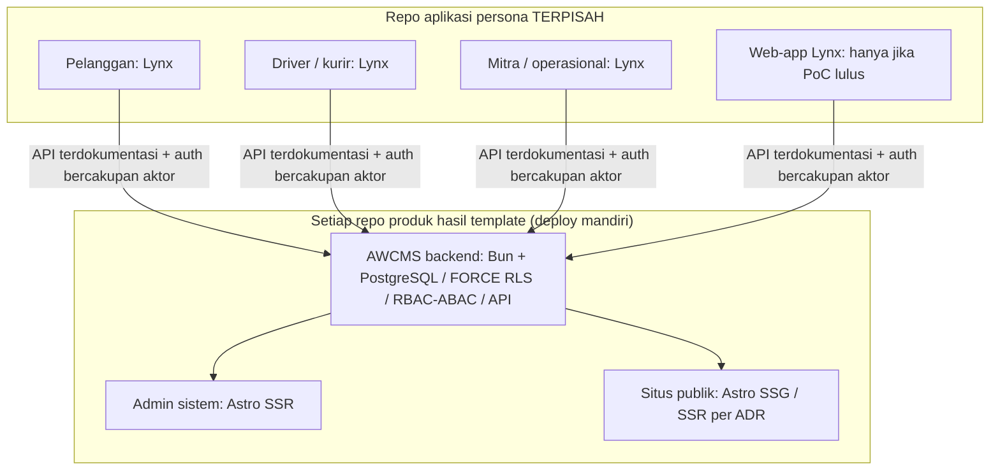

🇮🇩 Bahasa Indonesia · 🇬🇧 [English (source)](0050-lynxjs-for-separate-persona-apps-astro-stays-for-admin-and-public-profiles.md)

<!-- i18n-source-hash: sha256:87d0c45c4c4f8f85f35b20a84c4661dcbc544735434c57a22cfc106be2d3ca11 -->

# ADR-0050 — LynxJS/ReactLynx untuk aplikasi persona terpisah; Astro tetap untuk admin dan setiap profil publik

- **Status:** Accepted as direction; not implemented
- **Tanggal:** 20 Oktober 2026
- **Pengambil keputusan:** ahliweb
- **Terkait:** issue [#445](https://github.com/ahliweb/awcms-one/issues/445) (ADR ini); keputusan platform upstream [ahliweb/awcms#1133](https://github.com/ahliweb/awcms/issues/1133); [ADR-0024](0024-awcms-one-is-template-only-derived-apps-own-their-backend.id.md) (kepemilikan template-only); [ADR-0018](0018-awcms-one-is-a-template-with-build-profiles-and-an-idempotent-init.id.md) (profil build); [ADR-0016](0016-customer-accounts-are-otp-verified-commerce-accounts-with-bearer-sessions.id.md) (sesi bearer); [ADR-0017](0017-external-providers-are-commerce-owned-ports-with-env-credentials-and-token-addressed-webhooks.id.md) (kunci provider tetap di sisi server); pembagian peran ADR-0070 reference repo `awcms` upstream antara admin sistem dan lapisan pengalaman

## Konteks

Produk turunan dari template ini akan menginginkan aplikasi mobile berasa native untuk orang yang bukan editor atau administrator: pelanggan, kurir, pengemudi, mitra dan agen, petugas gudang. Pertanyaannya: teknologi UI apa untuk aplikasi tersebut, dan apa dampaknya bagi permukaan yang sudah dikirim repo ini.

ADR ini adalah **penjabaran khusus template** dari keputusan platform generik yang dilacak upstream di [ahliweb/awcms#1133](https://github.com/ahliweb/awcms/issues/1133). ADR ini tidak mengklaim hasil issue tersebut dan tidak menduplikasi pekerjaannya. **Bila #1133 mendarat berbeda, ADR ini harus ditinjau ulang**; sampai saat itu ia mencatat arah yang disetujui pemilik untuk template ini.

Fakta yang diverifikasi di repo ini pada 20 Oktober 2026:

- Workspace Bun-only. `apps/cms` adalah git subtree `ahliweb/awcms` (system of record di upstream; tidak diedit di sini untuk menyisipkan UI klien; sinkronisasi subtree berupa merge commit).
- `apps/storefront` adalah Astro, dengan `SITE_PROFILE` di `toko | berita | landing`, dibangun statis saat build (lihat [`status.md`](../status.id.md)).
- ADR-0024: repo ini bukan backend runtime bersama bagi produk turunan mana pun; tiap repo turunan memiliki backend, database, deployment, endpoint API dan operasional sendiri.
- Admin sistem AWCMS (`apps/cms/src/pages/admin/*`) adalah Astro, mengikuti upstream.

Acuan Lynx (diperiksa oleh proof of concept, tidak ditegaskan di sini): <https://lynxjs.org/next/>, <https://lynxjs.org/next/guide/compatibility.html>, <https://lynxjs.org/next/guide/build/index.html>. Semua pernyataan ADR ini tentang kemampuan Lynx dirumuskan sebagai "menurut dokumen terkait, diverifikasi di PoC".

## Keputusan

**D1. LynxJS/ReactLynx adalah kandidat teknologi UI yang diprioritaskan** untuk aplikasi persona (pelanggan, kurir, pengemudi, mitra/agen/reseller, petugas gudang) yang menyasar Android, iOS dan HarmonyOS. Ini kandidat, bukan komitmen: gerbang proof-of-concept (D6) menentukan, per repo konsumen.

**D2. Astro tidak berubah** untuk admin sistem/tenant/platform AWCMS, admin editorial/user bila ada, dan setiap profil website publik (`toko`, `berita`, `landing`). Tidak ada yang bermigrasi ke Lynx. Instalasi PWA atau "add to Home Screen" tidak mengubah permukaan Astro menjadi Lynx.

**D3. Aplikasi persona hidup di repositori terpisah**, di luar workspace ini (ADR-0024). Tidak ada aplikasi persona dan tidak ada kode Lynx yang ditambahkan ke `apps/storefront`, `apps/cms` atau root workspace oleh ADR ini. Setiap repo konsumen membuka issue dan ADR-nya sendiri.

**D4. Batas kontrak API.** Aplikasi persona mengonsumsi **API terdokumentasi dari backend produknya sendiri** (instance `apps/cms` repo turunan) dengan **autentikasi bercakupan aktor**. Ia tidak pernah menembak deployment referensi ini, tidak pernah mengimpor internals `apps/cms`, dan tidak pernah memegang kunci provider (pembayaran, WhatsApp, e-mail, peta): itu tetap di sisi server di balik port ADR-0017. Ancaman acuan: BOLA/IDOR, kebocoran token, secure storage, penyalahgunaan API.

**D5. Arsitektur build-time situs publik tidak disentuh.** SSG tetap default untuk setiap profil; SSR per rute hanya lewat ADR mendatang yang memvalidasi rute, keamanan, SEO, build dan deployment. Sitemap, SEO, robots, canonical dan CSP turunan tidak boleh regresi.

**D6. Gerbang proof-of-concept.** Sebelum repo konsumen memilih Lynx, PoC terpisah (di repo itu) harus mencakup: Chrome dan Safari iOS untuk Lynx for Web; Android, iOS dan HarmonyOS; autentikasi; secure storage lokal; deep link; perilaku offline; push; aksesibilitas; ukuran bundle dan performa; integrasi perangkat (kamera, lokasi, barcode); dan cakupan test. Fitur yang belum paritas dicatat. Lynx for Web dipilih untuk permukaan web transaksional bergaya `/app` hanya bila dukungan browser, push, offline dan deep link terbukti; bila tidak, fallback didokumentasikan di ADR (fallback-nya Astro, bukan anggapan bahwa semua platform setara).

**D7. Toolchain.** Repo ini tetap Bun-only. Apakah tooling resmi Lynx membutuhkan Node.js dinilai dalam PoC konsumen (menurut dokumen terkait, diverifikasi). ADR ini tidak mengubah pin Bun, tidak menambah toolchain kedua, dan tidak mengedit `bun.lock`; semua itu memerlukan ADR sendiri.

### Keputusan per permukaan

| Permukaan | Standar | Pemilik |
| --- | --- | --- |
| Admin sistem / tenant / platform | Astro SSR pada rute dinamis terautentikasi; bukan Lynx | Backend repo turunan (`apps/cms`), fondasi dari upstream |
| Admin editorial / user, bila ada | Astro SSR saat terautentikasi; rute statis sesuai use case | Lapisan pengalaman Astro (pembagian ADR-0070 reference repo `awcms`) |
| Publik `toko`, `berita`, `landing`, konten SEO, halaman pemasaran | Astro SSG saat ini; SSR per rute hanya via ADR | `apps/storefront`, profil tetap terisolasi |
| Aplikasi pelanggan, kurir, pengemudi, mitra, petugas gudang | Lynx/ReactLynx kandidat utama (Android/iOS/HarmonyOS) | Repo persona terpisah |
| Web mobile transaksional `/app` (akun, bukan SEO, bukan admin) | Lynx for Web hanya bila PoC lulus; bila tidak, fallback terdokumentasi | Repo persona |
| PWA admin, PWA storefront publik | Tetap Astro | Repo yang sudah memilikinya |

Panah bukan ketergantungan live ke `ahliweb/awcms-one`: backend adalah instance milik repo produk yang bersangkutan.

### Contoh klasifikasi

1. Aplikasi pelanggan: Lynx di Android/iOS (Web hanya bila PoC lulus). Katalog publik, halaman produk dan checkout SEO di `toko` tetap Astro.
2. Aplikasi kurir: Lynx dengan scan dan proof of delivery; izin kamera, lokasi dan push diverifikasi per platform.
3. Aplikasi pengemudi: Lynx dengan status tugas dan notifikasi; transisi pesanan idempoten dan diputuskan server.
4. Aplikasi mitra/agen/reseller: Lynx dengan dasbor akun dan komisi; kebijakan tenant dan peran ketat di API.
5. Aplikasi petugas gudang: Lynx dengan operasi barcode dan inventori; sinkronisasi offline dan penanganan konflik divalidasi di PoC.
6. Pengaturan produk, peran, izin, tenant, audit, administrasi stok: admin Astro, bukan Lynx.
7. Berita, landing, profil perusahaan dan halaman produk yang diindeks Google: Astro SSG/SSR, bukan Lynx.

### Matriks pemilihan SSG/SSR per profil

ADR ini tidak mengubah mode build profil mana pun; matriks mencatat di mana SSR akan dipertimbangkan dan apa yang harus dibuktikan ADR terlebih dahulu.

| Profil | Default saat ini | SSR dipertimbangkan hanya untuk | ADR SSR harus menunjukkan |
| --- | --- | --- | --- |
| `toko` | SSG; data runtime (keranjang, checkout, akun) di sisi browser terhadap API terdokumentasi | Rute yang kontennya tak dapat diketahui saat build dan relevan SEO | Rute, penurunan CSP, dampak sitemap/canonical, cerita deployment dan cache |
| `berita` | SSG dengan rebuild saat konten berubah | Kebutuhan kesegaran yang tak terpenuhi rebuild | Sama, ditambah perilaku feed dan redirect |
| `landing` | SSG | Tidak ada yang terlihat | Sama, bila pernah diusulkan |

## Analisis trade-off

| Kriteria | Lynx untuk app persona (dipilih) | Astro untuk semuanya (ditolak) | Lynx juga untuk admin/publik (ditolak) |
| --- | --- | --- | --- |
| Keamanan | Permukaan serang lebih kecil per persona (API bercakupan aktor); secure storage per platform diverifikasi | Batasan web storage untuk data persona sensitif | Admin dan publik pindah ke runtime yang belum terbukti |
| Performa | UI dirender native menurut dokumen terkait, diukur di PoC | Hanya web; lebih berat untuk alur scan/kamera | Tak diketahui untuk halaman SSR/SEO |
| Maintainability | Stack tambahan, tetapi terisolasi di repo terpisah | Satu stack | Dua stack dalam satu permukaan produk |
| Skalabilitas | Aplikasi tumbuh terpisah dari admin | Satu basis kode membesar | Risiko tulis ulang |
| Aksesibilitas | Harus diuji per platform | A11y web matang (WCAG 2.1 AA sudah ditegakkan di sini) | Risiko regresi pekerjaan yang ada |
| SEO | Tidak relevan untuk app persona; SEO publik tetap Astro | Terbaik | Kemungkinan regresi |
| UI/UX | Alur bergaya native untuk peran lapangan | Hanya gaya web | Campuran |
| Kompatibilitas | Android/iOS/HarmonyOS/Web berbeda; PoC mencatat celah | Luas | Tak diketahui |
| Kompleksitas operasional | Satu pipeline lagi per repo konsumen; tidak ada di sini | Tidak ada | Tinggi |
| Jangka panjang | Reversibel: kontrak API adalah sambungan yang stabil | Stabil | Mahal dibalik |

**Rekomendasi:** Lynx/ReactLynx untuk aplikasi persona terpisah, digerbangi PoC; Astro untuk admin dan semua profil publik. Ditolak: memindahkan admin, `apps/storefront` atau `apps/cms` ke Lynx; menaruh aplikasi persona di workspace ini; menjadikan storefront SSR secara default.

## Konsekuensi

- Repo ini hanya mengirim dokumentasi untuk keputusan ini: tanpa dependensi Lynx, tanpa workspace, tanpa perubahan perilaku. Test penjaga (`tests/lynx-direction.test.mjs`) gagal bila manifest workspace bergantung pada Lynx atau bila ADR kehilangan status "not implemented" saat belum ada kode Lynx.
- Repo konsumen membuka issue sendiri untuk PoC dan implementasi; acuan keamanan yang diterapkan: OWASP MASVS/ASVS, ISO/IEC 27001/27002/27005/27034/27701, UU PDP No. 27/2022 dan PP 71/2019, dengan pengujian di setiap platform yang benar-benar dirilis.
- Sinkronisasi subtree upstream tetap PR merge-commit terpisah.
