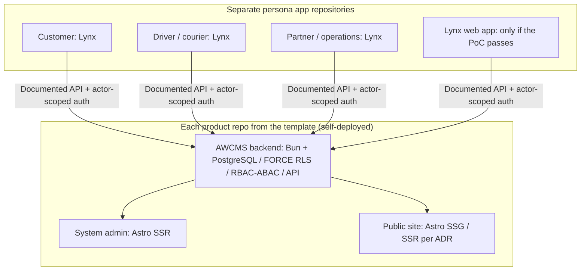

🇬🇧 English (source) · 🇮🇩 [Bahasa Indonesia](0050-lynxjs-for-separate-persona-apps-astro-stays-for-admin-and-public-profiles.id.md)

# ADR-0050 — LynxJS/ReactLynx for separate persona apps; Astro stays for the admin and every public profile

- **Status:** Accepted as direction; not implemented
- **Date:** 20 October 2026
- **Decision maker:** ahliweb
- **Related:** issue [#445](https://github.com/ahliweb/awcms-one/issues/445) (this ADR); upstream platform decision [ahliweb/awcms#1133](https://github.com/ahliweb/awcms/issues/1133); [ADR-0024](0024-awcms-one-is-template-only-derived-apps-own-their-backend.md) (template-only ownership); [ADR-0018](0018-awcms-one-is-a-template-with-build-profiles-and-an-idempotent-init.md) (build profiles); [ADR-0016](0016-customer-accounts-are-otp-verified-commerce-accounts-with-bearer-sessions.md) (bearer sessions); [ADR-0017](0017-external-providers-are-commerce-owned-ports-with-env-credentials-and-token-addressed-webhooks.md) (provider keys stay server-side); the reference repo `awcms` upstream ADR-0070 role split between the system admin and the experience layer

## Context

Derived products created from this template will want native-feeling mobile applications for people who are not editors or administrators: customers, couriers, drivers, partners and agents, warehouse staff. The question is which UI technology those applications should use, and what that means for the surfaces this repository already ships.

This ADR is the **template-specific elaboration** of the generic platform decision tracked upstream in [ahliweb/awcms#1133](https://github.com/ahliweb/awcms/issues/1133). It does not claim that issue's outcome and does not duplicate its work. **If #1133 lands differently, this ADR must be revisited**; until then it records the direction the owner approved for this template.

Facts verified in this repository on 20 October 2026:

- The workspace is Bun-only. `apps/cms` is a git subtree of `ahliweb/awcms` (system of record upstream; it is not edited here to insert client UI; subtree sync is a merge commit).
- `apps/storefront` is Astro, with `SITE_PROFILE` in `toko | berita | landing`, built statically at build time (see [`status.md`](../status.md)).
- ADR-0024: this repository is not the shared runtime backend of any derived product; each derived repository owns its backend, database, deployment, API endpoints and operations.
- The AWCMS system admin (`apps/cms/src/pages/admin/*`) is Astro, per upstream.

References for Lynx (to be checked by the proof of concept, not asserted here): <https://lynxjs.org/next/>, <https://lynxjs.org/next/guide/compatibility.html>, <https://lynxjs.org/next/guide/build/index.html>. Everything this ADR says about Lynx capabilities is phrased "per the linked docs, to be verified in the PoC".

## Decision

**D1. LynxJS/ReactLynx is the preferred candidate UI technology for persona applications** (customer, courier, driver, partner/agent/reseller, warehouse staff) targeting Android, iOS and HarmonyOS. It is a candidate, not a commitment: the proof-of-concept gate (D6) decides, per consumer repository.

**D2. Astro is unchanged** for the AWCMS system/tenant/platform admin, for the editorial/user admin where it exists, and for every public website profile (`toko`, `berita`, `landing`). Nothing migrates to Lynx. A PWA or "add to Home Screen" install does not turn an Astro surface into a Lynx one.

**D3. Persona apps live in separate repositories**, outside this workspace (ADR-0024). No persona app and no Lynx code is added to `apps/storefront`, `apps/cms` or the root workspace by this ADR. Each consumer repository opens its own issue and its own ADR.

**D4. API-contract boundary.** A persona app consumes the **documented API of its own product's backend** (the derived repository's `apps/cms` instance) with **actor-scoped authentication**. It never targets this reference deployment, never imports `apps/cms` internals, and never holds provider keys (payment, WhatsApp, e-mail, maps): those stay server-side behind the ports of ADR-0017. Reference threats: BOLA/IDOR, token leakage, secure storage, API abuse.

**D5. The public site's build-time architecture is untouched.** SSG remains the default for every profile; SSR is possible per route only through a future ADR that validates routes, security, SEO, build and deployment. Sitemap, SEO, robots, canonical and the derived CSP must not regress.

**D6. Proof-of-concept gate.** Before a consumer repository selects Lynx, a separate PoC (in that repository) must cover: Chrome and Safari iOS for Lynx for Web; Android, iOS and HarmonyOS; authentication; local secure storage; deep links; offline behaviour; push; accessibility; bundle size and performance; device integration (camera, location, barcode); and test coverage. Features without parity are recorded. Lynx for Web is chosen for a transactional `/app`-style web surface only if browser support, push, offline and deep links are proven; otherwise the fallback is documented in an ADR (the fallback is Astro, not an assumption that all platforms are equal).

**D7. Toolchain.** This repository stays Bun-only. Whether the official Lynx tooling needs Node.js is evaluated in the consumer PoC (per the linked docs, to be verified). This ADR does not change the Bun pin, add a second toolchain, or edit `bun.lock`; any of that requires its own ADR.

### Per-surface decision

| Surface | Standard | Owner |
| --- | --- | --- |
| System / tenant / platform admin | Astro SSR on authenticated dynamic routes; not Lynx | Backend of the derived repo (`apps/cms`), foundation from upstream |
| Editorial / user admin, where it exists | Astro SSR when authenticated; static routes per use case | Astro experience layer (reference repo `awcms` ADR-0070 split) |
| Public `toko`, `berita`, `landing`, SEO content, marketing pages | Astro SSG today; per-route SSR only via an ADR | `apps/storefront`, profiles stay isolated |
| Customer, courier, driver, partner, warehouse-staff apps | Lynx/ReactLynx preferred candidate (Android/iOS/HarmonyOS) | Separate persona repositories |
| Transactional mobile web `/app` (account, not SEO, not admin) | Lynx for Web only if the PoC passes; else documented fallback | Persona repository |
| Installable admin PWA, public storefront PWA | Stay Astro | The repository that already owns them |

The arrows are not a live dependency on `ahliweb/awcms-one`: the backend is the instance owned by the relevant product repository.

### Classification examples

1. Customer app: Lynx on Android/iOS (Web only if the PoC passes). The public catalog, product pages and SEO checkout on `toko` stay Astro.
2. Courier app: Lynx with scan and proof of delivery; camera, location and push permissions are verified per platform.
3. Driver app: Lynx with task status and notifications; order transitions are idempotent and decided by the server.
4. Partner/agent/reseller app: Lynx with an account and commission dashboard; strict tenant and role policy at the API.
5. Warehouse-staff app: Lynx with barcode and inventory operations; offline sync and conflict handling validated in the PoC.
6. Product settings, roles, permissions, tenants, audit, stock administration: Astro admin, not Lynx.
7. News, landing, company profile and Google-indexed product pages: Astro SSG/SSR, not Lynx.

### SSG/SSR selection matrix per profile

No profile changes build mode by this ADR; the matrix records where SSR would be considered and what an ADR must prove first.

| Profile | Default today | SSR considered only for | An SSR ADR must show |
| --- | --- | --- | --- |
| `toko` | SSG; runtime data (cart, checkout, account) is browser-side against the documented API | A route whose content cannot be known at build time and is SEO-relevant | Routes, CSP derivation, sitemap/canonical impact, deployment and cache story |
| `berita` | SSG with rebuild on content change | Freshness needs that a rebuild cannot meet | Same, plus feed and redirect behaviour |
| `landing` | SSG | Nothing foreseen | Same, if ever proposed |

## Trade-off analysis

| Criterion | Lynx for persona apps (chosen) | Astro for everything (rejected) | Lynx for admin/public too (rejected) |
| --- | --- | --- | --- |
| Security | Smaller attack surface per persona (actor-scoped API); secure storage per platform to verify | Web storage constraints for sensitive persona data | Admin and public move to an unproven runtime |
| Performance | Native-rendered UI per the linked docs, to be measured in the PoC | Web only; heavier for scan/camera flows | Unknown for SSR/SEO pages |
| Maintainability | Extra stack, but isolated in separate repos | One stack | Two stacks inside one product surface |
| Scalability | Apps scale independently of the admin | Single codebase grows | Rewrite risk |
| Accessibility | Must be tested per platform | Mature web a11y (WCAG 2.1 AA already enforced here) | Regression risk against the existing work |
| SEO | Not applicable to persona apps; public SEO stays Astro | Best | Likely regression |
| UI/UX | Native-style flows for field roles | Web-style only | Mixed |
| Compatibility | Android/iOS/HarmonyOS/Web differ; PoC records gaps | Broad | Unknown |
| Operational complexity | One more pipeline per consumer repo; none here | None | High |
| Long term | Reversible: the API contract is the stable seam | Stable | Costly to reverse |

**Recommendation:** Lynx/ReactLynx for separate persona apps, gated by the PoC; Astro for the admin and all public profiles. Rejected: moving the admin, `apps/storefront` or `apps/cms` to Lynx; putting persona apps in this workspace; making the storefront SSR by default.

## Consequences

- This repository ships documentation only for this decision: no Lynx dependency, no workspace, no behaviour change. A guard test (`tests/lynx-direction.test.mjs`) fails if a workspace manifest depends on Lynx or if the ADR loses its "not implemented" status while no Lynx code exists.
- Consumer repositories open their own issues for PoC and implementation; the security references to apply are OWASP MASVS/ASVS, ISO/IEC 27001/27002/27005/27034/27701, UU PDP No. 27/2022 and PP 71/2019, with tests on every platform actually released.
- Upstream subtree sync stays a separate merge-commit PR.
