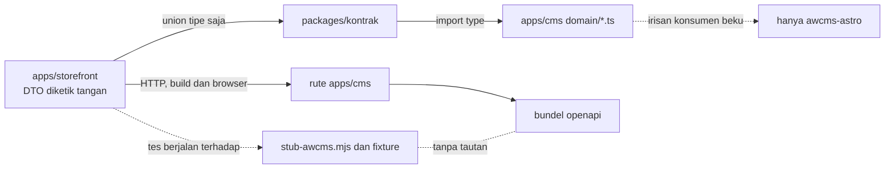

🇮🇩 Bahasa Indonesia · 🇬🇧 [English (source)](audit-paritas-kontrak-cms-storefront.md)

<!-- i18n-source-hash: sha256:ace99f0692f02255d57167f7f1c1aa14895db3acb50fdd9a6d8c86da8d1fdb9c -->

# Audit paritas kontrak: CMS dan storefront, tiga profil (issue #547)

Laporan riset, bukan spesifikasi dan bukan gerbang. Isinya apa yang **terbukti** hari ini tentang kontrak antara `apps/cms` (penyedia) dan `apps/storefront` (konsumen) untuk profil `toko`, `berita` dan `landing`, apa yang baru **diasumsikan**, dan apa yang sebaiknya ditambah tindak lanjut. Laporan ini tidak mengubah kode, skema, workflow, maupun tes.

- **Baseline:** `origin/main` `66b9985ad753d815ad8f85f6392487087f4a8e8f` (19 November 2026). Setiap pernyataan di bawah benar untuk pohon itu kecuali disebut lain.
- **Tanggal audit:** 20 November 2026.
- **Aturan kepemilikan yang dipakai:** [ADR-0024](adr/0024-awcms-one-is-template-only-derived-apps-own-their-backend.id.md). Repo ini template; sebuah temuan ditempatkan di repo yang memiliki kodenya. Tidak ada yang meminta template membawa kebutuhan produk atau tenant produk turunan.
- **Posisi alur:** masukan riset untuk langkah contract-first alur pengembangan (langkah 4 sampai 9 di [`AGENTS.md`](../AGENTS.md)). Laporan ini tidak menyatakan gerbang 9 lolos. Menurut aturan pemilik 19 November 2026, uji penerimaan pengguna (langkah 14) tidak dijalankan di sini; ia dijalankan di tiap repo turunan.

Sisi putus-putus "tanpa tautan" adalah temuan utama (F-01, F-02): tes dan end-to-end storefront berjalan terhadap stub yang ditulis tangan, dan tidak ada yang menghubungkan stub itu dengan dokumen OpenAPI yang menjadi acuan pemeriksaan CMS.

## 1. Kelas bukti

| Kelas | Arti |
| --- | --- |
| VERIFIED | Terbukti oleh tes, gerbang, atau perintah yang dijalankan untuk laporan ini, atau dengan membaca path sumber yang dikutip. Buktinya disebut. |
| ASSUMED | Dipercaya benar, belum dibuktikan di sini. Alasannya dinyatakan. |
| PLANNED | Issue terbuka atau dokumen sudah berkomitmen. Belum dibangun. |
| DEFERRED | Diketahui, dampak kecil saat ini, sengaja tidak dikejar laporan ini. |

## 2. Yang dijalankan

| Perintah (dari akar worktree kecuali disebut) | Hasil |
| --- | --- |
| `bun install --frozen-lockfile` | berhasil, 329 paket |
| `bun test tests/kontrak-arah-impor.test.mjs` | 2 lulus, 0 gagal |
| `bun run ci --leg local-ci/check-toko --leg local-ci/check-berita --leg local-ci/check-landing` | ketiganya PASS (`check-toko` 117,9 dtk dengan 10 langkah, `check-berita` 8,5 dtk dan `check-landing` 7,9 dtk dengan masing-masing 4 langkah) |
| `bun run ci --leg local-ci/e2e-landing` | PASS (31,3 dtk) |
| `bun run ci --leg local-ci/e2e-toko --leg local-ci/e2e-berita` | keduanya PASS (`e2e-toko` 76,9 dtk, `e2e-berita` 46,5 dtk) |
| `cd apps/cms && bun scripts/api-spec-check.ts` | `api:spec:check passed.`; `ROUTE_PARITY_EXEMPTIONS` kosong |
| `cd apps/cms && bun scripts/api-consumer-contract.ts --check` | OK, 15 path konsumen, semuanya untuk `awcms-astro` |
| `cd apps/cms && bun test tests/customer-bearer-body-boundary.test.ts tests/commerce-cors.test.ts tests/commerce-storefront-idempotency.test.ts tests/openapi-bundle.test.ts` | 49 lulus, 0 gagal (tanpa database) |

**Tidak dijalankan, dan alasannya.**

- `local-ci/check-cms` dan suite `tests/integration/`: butuh container `postgres:18.6` sementara dan database sekali pakai. Lingkungan audit tidak menyediakannya, sehingga tidak ada klaim berbasis database di bawah yang VERIFIED lewat eksekusi. Klaim semacam itu mengutip berkas tes yang mencakupnya dan menyebut "tidak dieksekusi".
- `local-ci/template-*` dan `local-ci/security`: di luar lingkup audit kontrak.
- Tidak ada klaim di laporan ini bahwa CI terbaru lulus pada SHA selain yang tertera di atas. `ci:pr` tidak dijalankan: PR ini hanya mengubah dokumentasi dan tidak ada status yang diposting.

**Pemeriksaan ad hoc, tidak di-commit.** Tiga skrip sekali pakai (disimpan di luar repo) melakukan perbandingan mekanis untuk F-02 sampai F-09: perbandingan path dan metode panggilan klien storefront terhadap OpenAPI bundel, perbandingan struktural tiap fixture storefront terhadap skema respons OpenAPI-nya, dan pemindaian sumber handler untuk `RATE_LIMITED` terhadap respons yang dideklarasikan. Metodenya dijelaskan di tempat dipakai agar peninjau dapat mengulang; versi permanen adalah rekomendasi, bukan bagian perubahan ini.

## 3. Yang sudah ada dan VERIFIED

| Pagar | Yang dibuktikan | Yang tidak dibuktikan |
| --- | --- | --- |
| `tests/kontrak-arah-impor.test.mjs` | Tidak ada berkas di `apps/cms/src` yang mengimpor `apps/storefront`, `packages/kontrak`, atau paket `@awcms-one/*`. Dijalankan: 2 lulus. | Arah sebaliknya (bahwa `packages/kontrak` hanya mengimpor berkas `domain/`); tes ini menyebut itu urusan tinjauan per PR. |
| `packages/kontrak` (`index.ts`, `katalog.ts`, `pesanan.ts`, `promosi.ts`) | 14 union string-literal diekspor ulang dengan `export type` dari `domain/*.ts` milik `apps/cms`; tanpa nilai runtime. Union yang melebar menjadi galat kompilasi storefront pada `switch` yang menyeluruh. | Bentuk objek apa pun. Docblock menyatakan bentuk DTO sengaja dibiarkan lokal di storefront. |
| `apps/cms` `api:spec:check` | Path OpenAPI dan handler rute API sepakat (paritas rute); himpunan pengecualian kosong. | Bentuk respons, dan rute di luar `/api` (lihat F-07). |
| `apps/cms` `api:consumer-contract:check` | Irisan beku yang dipanggil `awcms-astro` tetap subset aditif dari bundel. | Storefront di repo ini tidak termasuk irisan itu (F-01). |
| `apps/cms/tests/customer-bearer-body-boundary.test.ts` | Setiap operasi `customerBearer` berbody di OpenAPI terdaftar di middleware atau sengaja bebas sesi. | Pencarian sesi langsung, yang bergantung database dan tidak dieksekusi di sini. |
| `apps/cms/tests/commerce-cors.test.ts`, `commerce-storefront-idempotency.test.ts` | Kebijakan preflight: tanpa header kredensial, origin digaungkan, `idempotency-key` ada di daftar yang diizinkan untuk rute yang menerimanya. | Browser sungguhan terhadap rute sungguhan (F-10). |
| `apps/storefront/tests/*-kontrak.test.ts`, `toko-klien.test.ts`, `kirim-tunggal-kontrak.test.ts` | Perilaku sisi klien: amplop, `204`, `RATE_LIMITED` dengan `Retry-After`, single-flight, pemakaian ulang kunci idempotensi. | Bahwa server mengirim apa yang dipakai klien saat diuji. |
| `local-ci/check-*` dan `local-ci/e2e-*` | Type check dan smoke per profil; alur browser per profil, terhadap `apps/storefront/scripts/stub-awcms.mjs`. | Apa pun yang tidak dimodelkan stub (F-02, F-09). |

Kelas cacat yang dicari audit ini sudah pernah terjadi. Changeset 14 November 2026 `.changesets/2026-11-14-customer-bearer-body-boundary.md` mencatat bahwa lima belas rute pelanggan yang bermutasi dijawab `401 AUTH_REQUIRED` oleh middleware, dan bahwa "handler-level tests and `api:spec:check` never saw it". Storefront hijau sepanjang waktu karena stub-nya tidak pernah memiliki middleware itu.

## 4. Matriks: operasi ke bukti, per profil

Membaca kolom. **Pemanggil** adalah pengirim permintaan: *build* adalah `astro build` dengan kredensial mesin `AWCMS_API_TOKEN`; *browser* adalah pembeli atau pembaca, lintas-origin, tanpa cookie. **DTO** adalah asal tipe konsumen. **Stub** menyatakan apakah `apps/storefront/scripts/stub-awcms.mjs` melayaninya. **Status** adalah kelas bukti untuk "harapan konsumen sama dengan perilaku penyedia".

Keanggotaan profil mengikuti `apps/storefront/src/config/profil.ts` dan `apps/storefront/integrations/profil.mjs`: `toko` adalah halaman bersama ditambah grup `toko` ditambah grup `berita`; `berita` adalah halaman bersama ditambah grup `berita`; `landing` hanya halaman bersama.

### 4.1 Dipakai bersama oleh ketiga profil

| Operasi | Pemanggil dan auth | Sumber DTO | Penanganan galat dan tepi | Tenant | Stub | Tes atau gerbang | Status |
| --- | --- | --- | --- | --- | --- | --- | --- |
| `GET /api/v1/site-profile/composed` | build, bearer | `SiteProfile` lokal di `apps/storefront/src/lib/awcms/profil.ts` | build gagal keras tanpa kredensial (`client.ts`) | token | fixture | `profil.test.ts`, `profil-konfig.test.ts`; fixture cocok dengan skema (F-02) | bentuk VERIFIED, perilaku ASSUMED |
| `GET /theming/{tenantCode}/tokens.css` | build, tanpa auth, CSS mentah | tidak ada (teks mentah) | penanganan non-`200` di `apps/storefront/src/lib/awcms/theme.ts` | `AWCMS_TENANT_CODE` | fixture | `theme.test.ts` | **tidak ada di OpenAPI** (F-07) |
| `GET /api/v1/blog/pages/public` dan `/{slug}` | build, bearer | tipe lokal di `apps/storefront/src/lib/awcms/pages.ts` | `null` untuk halaman yang tidak ada | token | fixture | hanya build smoke: tidak ada tes unit yang mengimpor `apps/storefront/src/lib/awcms/pages.ts` | bentuk VERIFIED (fixture bersih), perilaku ASSUMED |
| `GET /api/v1/media/objects?ids=` dan `/media/public-origin` | build, bearer | tipe lokal di `apps/storefront/src/lib/awcms/media.ts` | hasil parsial ditoleransi | token | stub meniru filter asli | `awcms-media.test.ts` | VERIFIED untuk `public-origin`; fixture `objects` adalah tabel pencarian, bukan respons, sehingga tidak dapat dibandingkan |
| `POST /api/v1/analytics/collect` | browser, anonim, terikat origin | tidak ada | beacon, kirim lalu lupakan | origin | stub | `analitik*.test.ts`, dan `analytics-beacon-cors.test.ts` di `apps/cms` | VERIFIED tingkat unit, ASSUMED ujung ke ujung |
| `/csp.json` dan `halaman/[slug]` bersama saat build | build | n/a | build landing tanpa CMS gagal saat ini | n/a | n/a | issue terbuka #535 | PLANNED |

### 4.2 Grup `toko` (hanya dibangun profil `toko`)

| Operasi | Pemanggil dan auth | Sumber DTO | Penanganan galat dan tepi | Idempotensi | Stub | Tes atau gerbang | Status |
| --- | --- | --- | --- | --- | --- | --- | --- |
| `GET /api/v1/commerce/{products,categories}` | build, bearer | `CommerceProduct` lokal; union dari `packages/kontrak` | halaman keyset | tidak ada | fixture | `katalog-catalog.test.ts` | **field basi** (F-03) |
| `GET /api/v1/commerce/{store-settings/public,sliders,flash-sales,vouchers,testimonials,popups}` | build, bearer | tipe lokal di `apps/storefront/src/lib/awcms/pemasaran.ts` | popup `null` | tidak ada | fixture | `katalog-pemasaran.test.ts` | pengaturan toko **basi** (F-04) |
| `POST .../storefront/cart/quote` | browser, bearer opsional | `CartQuote` lokal di `toko-klien.ts` | `CART_CHANGED` membawa kuotasi baru | tidak ada | mesin status | `toko-klien.test.ts`, `checkout.e2e.ts` | VERIFIED sisi klien; uang sebagai string; `tax` lebih sempit dari spesifikasi (F-11) |
| `POST .../storefront/orders` | browser, bearer opsional | `Order` lokal | `409`, `401` eksplisit bila bearer basi | kunci di body | mesin status | `checkout.e2e.ts`, `checkout-ulang-jaringan.e2e.ts` | VERIFIED hanya terhadap stub |
| `GET .../orders/{code}`, `POST .../cancel`, `.../payment-confirmations` | browser | `Order` lokal | `404` netral | header opsional, hanya prosa (F-08) | mesin status | `pesanan-poll.test.ts` | VERIFIED hanya terhadap stub |
| `POST .../payment-gateway/sessions` | browser | lokal | `503` bila tanpa gateway | tidak ada | mesin status | `gateway-build-smoke.test.ts` | VERIFIED hanya terhadap stub |
| `POST .../payment-proof/upload-sessions` dan `/finalize` | tidak ada: tidak ada halaman yang memanggil | `UploadSession` di `toko-klien.ts` | CMS selalu menjawab `503` | tidak ada | `503` | tidak ada | DEFERRED, spesifikasi menyebut "reserved" (F-12) |
| `POST .../reviews` | browser, bearer opsional | lokal | `409` | header opsional, hanya prosa | mesin status | `toko-klien.test.ts` | spesifikasi tidak memuat `429` (F-09) |
| `.../account/otp/{request,verify}`, `me`, `logout` | browser, bearer setelah verify | `akun-kontrak.ts` | `401` menghapus sesi tersimpan; `204` pada logout | hanya prosa | mesin status | `akun-klien.test.ts`, `akun-kontrak.test.ts`, `daftar-ketuk-ganda.e2e.ts` | VERIFIED sisi klien; batas middleware tidak punya bukti dari sisi storefront |
| `.../account/{addresses,wishlist,orders,reviews,affiliate,conversations,loyalty}` | browser, bearer | tipe lokal di `akun-klien.ts` | `204` untuk hapus, `409`, `429` | hanya prosa | mesin status, **loyalty tidak ada** | `akun-klien.test.ts`, `poin-kontrak.test.ts` | VERIFIED sisi klien; `loyalty` tanpa rute stub (F-13) |
| `.../account/push/*` | browser, bearer | tipe lokal | `204`, `429`, `413`, `415`, `422` | tidak ada | `stub-push.mjs` | `push-*.test.ts`, `akun-notifikasi.e2e.ts` | VERIFIED terhadap stub; issue #430 masih terbuka sementara `docs/api.md` menyebutnya terimplementasi (F-14) |
| `.../booking/{offerings,availability,quote,reservations...}` | browser, bearer untuk reservasi sendiri | `booking-kontrak.ts` | `HOLD_LIMIT_EXCEEDED`, `SLOT_UNAVAILABLE`, uang string dibandingkan persis | **header wajib, dideklarasikan di spesifikasi** | `stub-booking.mjs` | `booking-kontrak.test.ts`, `booking.e2e.ts` | VERIFIED terhadap stub; satu-satunya grup dengan kontrak idempotensi yang terbaca mesin |
| `GET .../products/{id}/download`, `.../account/entitlements*`, `.../document-links/{token}` | tidak ditemukan pemanggil storefront | tidak ada | n/a | n/a | tidak ada | tidak ada | DEFERRED (hanya spesifikasi) |
| `GET /api/v1/idn-regions/regions` | build dan checkout | `wilayah.ts`, `wilayah-checkout.ts` | konkurensi dibatasi | tidak ada | fixture | `wilayah-checkout.test.ts` | fixture **di luar enum** (F-05) |

### 4.3 Grup `berita` (dibangun `toko` dan `berita`)

| Operasi | Pemanggil dan auth | Sumber DTO | Stub | Tes atau gerbang | Status |
| --- | --- | --- | --- | --- | --- |
| `GET /api/v1/blog/{posts,terms,institutions}` | build, bearer | tipe lokal di `apps/storefront/src/lib/awcms/blog.ts` | fixture, dipangkas | `berita-routes.test.ts`, `berita-build-smoke.test.ts` | proyeksi terpangkas (F-02) |
| `GET /api/v1/news-portal/ad-placements/active` | build, bearer | lokal | fixture | `iklan-popup.e2e.ts` | bentuk VERIFIED (fixture bersih) |
| `GET /api/v1/seo/redirects` | build, bearer | `RawRedirect` lokal, subset yang dideklarasikan | fixture, dipangkas | `pengalihan-aturan.test.ts`, `berita-build-smoke.test.ts` | proyeksi terpangkas (F-02) |
| `GET /api/v1/analytics/pages?range=7d` | build, bearer | lokal | fixture | `analitik-terpopuler.test.ts` | bentuk VERIFIED (fixture bersih) |
| `POST /api/v1/newsletter/{subscribe,confirm,unsubscribe}` | browser, anonim | `apps/storefront/src/scripts/buletin.ts`, lokal | stub | `newsletter-path-contract.test.ts` | VERIFIED untuk dua path tautan e-mail lewat keberadaan berkas; bentuk permintaan dan respons ASSUMED |
| `GET /api/v1/news-portal/homepage-sections/composed` | tidak ada: sengaja tidak dipanggil | n/a | n/a | n/a | DEFERRED, `blog.ts` menjelaskan alasannya |

### 4.4 Ringkasan per profil

| Profil | Operasi yang diandalkan | Bukti terkuat | Bukti terlemah |
| --- | --- | --- | --- |
| `landing` | hanya himpunan bersama di 4.1 | `check-landing` PASS, `e2e-landing` PASS (laporan ini) | tidak dapat dibangun tanpa CMS (#535); semua pembacaan bersama hanya terhadap stub |
| `berita` | 4.1 ditambah 4.3 | `check-berita` PASS; keenam pembacaan saat build berupa fixture bersih atau subset yang dideklarasikan | body permintaan dan respons newsletter; fixture terpangkas |
| `toko` | 4.1, 4.3 dan 4.2 | `check-toko` PASS; himpunan tes klien terbesar; uang sebagai string | setiap panggilan browser hanya dibuktikan terhadap stub; batas middleware CMS dan CORS per rute tidak diuji dari sisi storefront |

## 5. Protokol: tipe TypeScript bukan kontrak

`packages/kontrak` menjawab satu pertanyaan: apakah kosakata tertutup konsumen masih memuat setiap nilai yang dapat dikeluarkan penyedia. Itu perlu dan murah. Ia tidak menjawab yang lain di bawah, dan laporan ini tidak merekomendasikan perubahan yang membuatnya mencoba: **tanpa impor runtime dari `packages/kontrak`, dan pagar arah impor tetap wajib** (lihat bagian 8).

| Perhatian | Yang dibuktikan tipe | Yang harus dibuktikan dengan cara lain | Tempat dibuktikan hari ini |
| --- | --- | --- | --- |
| Nama dan tipe field | hanya untuk 14 union | bentuk permintaan dan respons terhadap skema OpenAPI | hanya sisi penyedia; sisi storefront dengan tangan (F-02) |
| Amplop `{success, data}` dan galat `{code, message, details}` | tidak ada | konsumen mengurai kode galat penyedia, termasuk yang tidak dikenal | `toko-permintaan.ts` plus tes unit; kode stub ditulis tangan |
| `204 No Content` | tidak ada | klien tidak memanggil `.json()` padanya | `toko-permintaan.ts` kembali lebih awal pada `204`; VERIFIED dengan membaca dan `toko-klien.test.ts` |
| `429` dan `Retry-After` | tidak ada | penyedia mendeklarasikan `429` di setiap rute berbatas; klien membaca header | klien VERIFIED; spesifikasi tidak lengkap (F-09); tidak ada rute stub yang mengeluarkan `RATE_LIMITED` |
| Idempotensi | tidak ada | penyedia mendeklarasikan kunci header atau body; klien mengirim satu kunci stabil per percobaan | klien VERIFIED (`kunci-idempotensi.test.ts`); spesifikasi mendeklarasikan header pada dua operasi saja (F-08) |
| CORS dan preflight | tidak ada | jawaban preflight memuat setiap header yang dikirim klien, per rute | penyedia diuji unit; stub menjawab satu daftar seragam untuk semua rute (F-10) |
| Resolusi tenant | tidak ada | `Origin` permintaan menentukan tenant; origin yang tidak dikenal mendapat `404` netral | stub memodelkannya; rute asli dicakup tes berbasis database yang tidak dieksekusi di sini |
| Bearer pelanggan | tidak ada | token `cs_` lolos middleware untuk rute berbody | tes penyedia ada setelah perbaikan 14 November; tanpa bukti sisi konsumen |
| Uang | tidak ada | jumlah `numeric(14,2)` melintas sebagai string dan tidak diurai untuk aritmetika | VERIFIED: `apps/storefront/src/lib/harga.ts` mengubah ke `Number` hanya untuk tampilan, dengan tes pagar; `katalog-harga.test.ts` |
| Status UI | tidak ada | loading, kosong, galat, `401` dan `429` masing-masing punya status | per halaman, kebanyakan lewat e2e terhadap stub; tidak ada inventaris (F-15) |

## 6. Temuan

Tingkat keparahan adalah dampak pada pembeli atau pembaca bila celahnya nyata, bukan usaha untuk menutupnya. "Pemilik" adalah repo yang memiliki perbaikannya (ADR-0024 D2).

| ID | Temuan | Kelas | Bukti | Keparahan | Pemilik |
| --- | --- | --- | --- | --- | --- |
| F-01 | Tidak ada kontrak konsumen beku untuk panggilan storefront. `api:consumer-contract:check` membekukan 15 path, semuanya untuk `awcms-astro`. Tidak satu pun dari 41 operasi storefront yang dipanggil klien, dan tidak satu pun pembacaan saat build, yang dibekukan, sehingga perubahan respons pada sinkron subtree tidak tertangkap sebelum storefront berjalan. | VERIFIED | `apps/cms/scripts/api-consumer-contract.ts`; dijalankan: OK, 15 path | tinggi | `awcms-one` untuk irisannya; `awcms` untuk mekanismenya (lihat bagian 8) |
| F-02 | Fixture stub ditulis tangan dan tidak ada gerbang yang membandingkannya dengan skema OpenAPI. Perbandingan struktural 19 fixture menemukan 11 bersih, 3 yang bertentangan dengan skema (F-03 sampai F-05), 4 yang tidak memuat field wajib (blog posts, terms, institutions, redirects; dikonsumsi sebagai subset yang dideklarasikan), dan 1 yang berupa tabel pencarian, bukan respons. | VERIFIED | perbandingan ad hoc terhadap `apps/cms/openapi/awcms-public-api.openapi.yaml` pada SHA baseline | tinggi | `awcms-one` |
| F-03 | `downloadLink` sengaja tidak ada di rekaman produk publik (header OpenAPI menyatakannya dan `toAdminRecord` menambahkannya hanya untuk admin), namun fixture membawa `downloadLink: null` dan tipe storefront `CommerceProduct` mendeklarasikan `downloadLink: string \| null` sebagai wajib. Tipe mengklaim field yang tidak lagi dikirim penyedia. | VERIFIED | header `apps/cms/openapi/modules/commerce.openapi.yaml`; `toAdminRecord` di `apps/cms/src/modules/commerce/application/product-directory.ts`; `apps/storefront/src/lib/catalog.ts` | rendah (tidak ada halaman yang membacanya) | `awcms-one` |
| F-04 | Fixture `store-settings-public` memiliki `payment.tax` tanpa `mode`, padahal skema menjadikannya union terdiskriminasi pada `mode` (issue tertutup #324), dan objek `shipping.courier` yang tidak ada di skema. Fixture basi terhadap perilaku penyedia. Apakah rute hidup mengirim `shipping.courier` tidak ditelusuri. | VERIFIED untuk fixture, ASSUMED untuk rute | skema `CommerceStoreSettingsPublic`; berkas fixture | sedang | `awcms-one` |
| F-05 | Fixture wilayah memiliki `regionType: "city"`; enum skema adalah `province`, `regency`, `district`, `village`. Storefront mengetik field itu sebagai `string`, sehingga tidak ada kompilator yang akan menyadari nilai nyata di luar himpunan. | VERIFIED | `apps/cms/openapi/modules/idn-admin-regions.openapi.yaml`; `apps/storefront/src/lib/awcms/wilayah.ts` | rendah | `awcms-one` |
| F-06 | `packages/kontrak` lebih sempit dari namanya: 14 union, tanpa bentuk objek, secara sengaja. `PaymentMethod`, `PaymentStatus` dan `ShippingMethod` diekspor tetapi tidak diimpor di mana pun di storefront. Ini konsisten dengan keputusan issue #6; celahnya adalah tidak ada yang mengimbangi (F-01). | VERIFIED | `packages/kontrak/src/*.ts`; pencarian kata utuh di `apps/storefront/src` dan `tests` | rendah | `awcms-one` |
| F-07 | `GET /theming/{tenantCode}/tokens.css` dibaca semua profil saat build dan tidak ada di bundel OpenAPI, sehingga `api:spec:check` tidak mencakupnya. Perubahan pada rute itu sampai ke storefront tanpa sinyal. | VERIFIED | berkas rute `apps/cms/src/pages/theming/[tenantCode]/tokens.css.ts`; nol kecocokan di bundel; panggilan di `apps/storefront/src/lib/awcms/theme.ts` | sedang | `awcms` (rute dan kontrak) |
| F-08 | Idempotensi terbaca mesin hanya pada dua operasi booking. Dua belas operasi storefront bermutasi lain menyebut idempotensi dalam prosa tanpa parameter header, dan sembilan berkas rute lain merujuknya. Solusi bernama di ADR-0129 upstream (`IdempotencyKeyOptional`) tidak ada. | VERIFIED | `apps/cms/openapi/awcms-public-api.openapi.yaml`; pencarian rute; ADR-0129 upstream | sedang | `awcms` |
| F-09 | 25 operasi storefront yang sumber handler-nya memuat literal `RATE_LIMITED` tidak mendeklarasikan respons `429`, termasuk `POST /reviews` dan `GET /products/{productId}/download`. Angkanya heuristik statis: pemeriksaan per rute diperlukan sebelum spesifikasi diedit. Tidak ada rute stub yang mengembalikan `RATE_LIMITED`, sehingga cabang klien hanya dibuktikan tes unit. | VERIFIED (heuristik) | pemindaian handler terhadap bundel; `apps/storefront/scripts/stub-awcms.mjs` | sedang | `awcms` untuk spesifikasi; `awcms-one` untuk stub |
| F-10 | Stub menjawab satu daftar `Access-Control-Allow-Headers` seragam di setiap rute storefront, sedangkan rute asli masing-masing mendeklarasikan daftarnya sendiri. Stub karenanya lebih longgar daripada penyedia, dan jalannya e2e tidak dapat mendeteksi header yang hilang pada satu rute. | VERIFIED dengan membaca | preflight stub (`Content-Type, Authorization, Idempotency-Key`); handler `OPTIONS` asli di bawah `apps/cms/src/pages/api/v1/commerce/storefront` | sedang | `awcms-one` |
| F-11 | Storefront memodelkan `CartQuote.tax` sebagai `{active, percent, amount}`. Spesifikasi menambah `mode`, `inclusive`, `error` dan `engine`, dan pada mode engine `active` serta `percent` tidak dijanjikan. Tidak ada halaman yang menampilkan pajak, sehingga dampaknya nol saat ini. | VERIFIED celah tipe, DEFERRED dampak | `apps/storefront/src/lib/toko-klien.ts`; skema `CommerceCartQuoteResult` | rendah | `awcms-one` |
| F-12 | Fungsi klien unggah bukti bayar ada dan tidak ada halaman yang memanggilnya; penyedia selalu menjawab `503`. Dicadangkan di kedua sisi. | VERIFIED, DEFERRED | `apps/storefront/src/lib/toko-klien.ts`; `apps/cms/openapi/modules/commerce.openapi.yaml` | tidak ada | n/a |
| F-13 | `GET .../account/loyalty` dipanggil checkout (`ambilPoin`) dan tidak punya rute stub, sehingga alur poin hanya diuji tes unit, tidak oleh run browser mana pun. | VERIFIED | `apps/storefront/src/lib/akun-klien.ts`; `grep loyalty scripts/stub-awcms.mjs` kosong | rendah | `awcms-one` |
| F-14 | `docs/api.md` menyebut Web Push pelanggan terimplementasi sementara issue #430 terbuka. Salah satunya basi. Tidak diselesaikan di sini. | VERIFIED selisih, penyebab ASSUMED | `docs/api.md`; daftar issue | rendah | `awcms-one` |
| F-15 | Tidak ada inventaris status UI (loading, kosong, galat, `401`, `429`) yang diimplementasikan tiap halaman, sehingga "UI states" pada issue tidak dapat diaudit di luar alur e2e yang tercantum di matriks. | VERIFIED ketiadaan | tidak ada dokumen atau tes yang menyebutkannya | sedang | `awcms-one` (perlu langkah UX lebih dulu) |
| F-16 | Cakupan browser per profil tidak merata secara sengaja: checkout, booking, pengaturan push dan alur akun hanya berjalan di `toko`; popup iklan berita hanya di `berita`; `landing` memiliki run aksesibilitas dan navigasi bersama. | VERIFIED | `test.skip(!isGroupActive(...))` di `apps/storefront/tests/e2e` | informasi | n/a |

### 6.1 Interaksi dengan PR #530

PR #530 (`integration/2026-11-11-close-out`, head `6413f4f4a2bf39d5ab34450ef7997df7183a0a52`, status OPEN, mergeability UNKNOWN saat audit) dimiliki pihak lain dan tidak disentuh, di-merge, di-rebase ke, atau diuji di sini. Laporan ini berbasis `origin/main` `66b9985ad753d815ad8f85f6392487087f4a8e8f`.

PR #530 dapat mengubah temuan ini:

- **Batas bearer pelanggan.** `origin/main` sudah memuat perbaikan lima belas rute (changeset 14 November 2026, tes dijalankan di atas). Badan PR menyatakan registrinya tumbuh menjadi delapan belas entri dengan menambah tiga rute `privacy/*` untuk issue #529. Setelah ia di-merge, jumlah registri, matriks 4.2 dan jumlah operasi F-09 masing-masing akan lebih tinggi.
- **Permukaan storefront baru.** PR menambah `/akun/privasi` dan rutenya. Keduanya tidak ada di audit ini.
- **Draf kontrak #464.** Hanya draf; tidak diaudit.
- **Basis subtree.** Sinkron subtree PR lebih tua daripada `origin/main` (yang kemudian sudah menyinkron ke upstream yang lebih baru). PR menyebut ia ditumpuk di atas #543, yang sudah di-merge. Jalankan ulang temuan numerik (F-08, F-09) setelah PR mendarat.

Tidak ada temuan di sini yang bergantung pada berkas yang diubah PR dengan cara yang membuatnya salah hari ini; masing-masing mungkin butuh pembaruan angka sesudahnya.

## 7. Mock atau fixture ringan: kapan, dan siapa pemiliknya

Pertanyaan pada langkah 3 issue. Tiga tingkat, masing-masing dengan pemilik.

| Tingkat | Pakai bila | Pemilik | Biaya |
| --- | --- | --- | --- |
| **Fixture** (JSON ditulis tangan, seperti `tests/fixtures/awcms/` hari ini) | konsumen membaca subset yang dideklarasikan, respons kecil dan stabil, dan orang harus dapat membaca datanya sebagai JSON polos | `awcms-one` untuk baseline template; tiap produk turunan untuk kontennya sendiri | rendah, tetapi bergeser diam-diam (F-02 sampai F-05) |
| **Fixture plus pemeriksaan skema** (gerbang yang memvalidasi tiap fixture terhadap skema respons OpenAPI, dengan subset yang dideklarasikan diizinkan) | fixture adalah satu-satunya yang berdiri di antara konsumen dan bentuk asli penyedia | `awcms-one` untuk gerbang dan fixture; `awcms` menyediakan skema dan tidak diminta berubah | rendah sampai sedang; menutup F-02 sampai F-05 tanpa perkakas generasi baru |
| **Mock hasil generasi** (server yang dihasilkan dari dokumen OpenAPI, termasuk contoh galat dan `429`) | konsumen dibangun sebelum penyedianya (langkah 11.1 terhadap kontrak langkah 8), atau saat alur berstatus seperti kuotasi, pesanan dan pembatalan harus cocok dengan spesifikasi, bukan ingatan seseorang tentangnya | generator dan konfigurasinya bersifat generik dan milik upstream `awcms`; data seed per produk milik repo produk | sedang sampai tinggi; juga menambah dependensi |

Rekomendasi, sebagai usulan untuk pemilik, bukan keputusan: adopsi **fixture plus pemeriksaan skema** di repo ini lebih dulu, karena tidak memerlukan dependensi runtime baru dan menghilangkan celah terverifikasi terbesar. Perlakukan mock hasil generasi sebagai usulan upstream ke `awcms` hanya bila lebih dari satu konsumen membutuhkannya. Ketiga tingkat tidak saling meniadakan; yang kedua adalah peningkatan ketat dari yang pertama.

## 8. Rekomendasi, dengan keputusan yang menunggu pemilik

1. **Pertahankan pagar arah impor dan aturan type-only.** Jangan menambah impor runtime dari `packages/kontrak` dan jangan melebarkannya ke bentuk objek: docblock memberi alasannya (situs publik statis tidak boleh membawa kode `apps/cms` ke bundel klien) dan tidak ada di audit ini yang membantahnya.
2. **Tutup F-01 dan F-02 bersama** dengan irisan kontrak konsumen storefront dan pemeriksaan fixture terhadap skema yang berjalan di `local-ci/check-toko`. Irisan mengikuti aturan subset aditif yang sudah dipakai `api:consumer-contract:check`. Mekanismenya ada di `apps/cms`, yang tidak boleh diedit langsung oleh repo ini; irisan storefront dapat berada di akar repo (`tests/` atau `tools/`), sehingga tidak perlu perubahan subtree untuk memulai.
3. **Laporkan F-07, F-08 dan F-09 ke upstream** (`awcms`) daripada menambal `apps/cms` di sini: tambahkan rute CSS mentah ke kontrak atau ke daftar izin non-API yang eksplisit, tambahkan komponen parameter header opsional, dan lengkapi respons `429` setelah pemeriksaan per rute.
4. **Perbaiki F-03 sampai F-05 pada fixture dan tipe storefront** setelah gerbang pada butir 2 ada, agar gerbanglah yang pertama menjadi merah.
5. **Jangan membuka issue implementasi sebelum gerbang 9.** Epik pemilik pekerjaan ini melarangnya; usulan di bawah adalah teks untuk langkah itu kelak.

### 8.1 Keputusan pemilik (diputuskan 20 November 2026)

Tiga keputusan yang menunggu pemilik diputuskan pada 20 November 2026 dan dicatat di [ADR-0058](adr/0058-contract-parity-fixtures-with-schema-check-consumer-slice-at-the-root-and-generic-gaps-go-upstream.md).

| Keputusan | Hasil | Ke mana |
| --- | --- | --- |
| Letak irisan kontrak konsumen | `tests/` akar repo ini, bukan `apps/cms` (subtree) | [#555](https://github.com/ahliweb/awcms-one/issues/555), [#556](https://github.com/ahliweb/awcms-one/issues/556) |
| Strategi mock | fixture plus pemeriksaan skema lebih dulu; mock hasil generasi menyusul hanya bila perlu | [#553](https://github.com/ahliweb/awcms-one/issues/553), [#554](https://github.com/ahliweb/awcms-one/issues/554) |
| Apakah `RATE_LIMITED` dan `IdempotencyKeyOptional` termasuk kontrak generik `awcms` | ya, dilaporkan ke upstream dan tidak ditambal di `apps/cms`: [ahliweb/awcms#1385](https://github.com/ahliweb/awcms/issues/1385) (upstream juga memilih menerbitkan paket fixture terpatok untuk konsumen) | [#557](https://github.com/ahliweb/awcms-one/issues/557) mengadopsinya setelah sinkron subtree berikutnya |

### 8.2 Usulan kriteria penerimaan dan Definition of Ready untuk issue atomik kelak

Ini awalnya usulan. Setelah keputusan pemilik 20 November 2026 (bagian 8.1) ia dibuka sebagai issue backlog #553 sampai #557, semuanya menunggu gerbang 9 dan Definition of Ready dan belum ada yang diimplementasikan: Issue A adalah #553 (dengan #554 untuk F-03 sampai F-05), Issue B adalah #555 dan #556, dan tindak lanjut upstream adalah #557. Pemeriksaan duplikat pada baseline (sebelum issue-issue itu ada): tidak ada issue terbuka maupun tertutup di repo ini yang mencakup paritas fixture terhadap skema atau irisan kontrak konsumen storefront. Terkait, dan bukan duplikat: #6 (tertutup, fondasi type-only), #430 dan #431 (push), #535 (build landing tanpa CMS), #420 (pelacakan upstream).

**Issue A. Gerbang fixture terhadap skema.**

- Untuk tiap fixture di `apps/storefront/tests/fixtures/awcms`, gerbang menemukan skema respons OpenAPI yang sesuai dan gagal pada nilai di luar enum, ketidakcocokan tipe, atau properti yang tidak dideklarasikan skema; fixture yang dinyatakan sebagai subset dicantumkan beserta field yang dibaca konsumen.
- Gerbang berjalan di `local-ci/check-toko`, tidak butuh database maupun jaringan, dan ditambahkan ke deskripsi leg di `tools/ci/legs.ts`.
- F-03, F-04 dan F-05 diperbaiki dalam perubahan yang sama, atau gerbang membawa pengecualian bernama dan bertanggal.
- Tidak mengedit `apps/cms`, tidak mengimpor dari `packages/kontrak`, tidak menambah dependensi runtime padanya.

**Issue B. Irisan kontrak konsumen storefront.**

- Berkas beku mendaftar operasi dan skema yang dipanggil storefront, dalam bentuk superset aditif milik `api:consumer-contract:check`.
- Meregenerasinya adalah tindakan sengaja dengan alasan yang dinyatakan di pull request.
- Mencakup pembacaan saat build dan panggilan browser, dan menyebut rute F-07 secara eksplisit.

**Definition of Ready untuk keduanya.** Kontrak langkah 8 untuk permukaan itu sudah ditinjau; profil tempat tiap operasi berada tercantum (bagian 4); kasus negatif (`401`, `404`, `409`, `429`, `204`) dinamai per operasi; pemilik tiap fixture dinyatakan; tidak ada konten khusus konsumen masuk ke template (ADR-0024 D3).

## 9. Kriteria penerimaan issue #547

| Kriteria | Tempat terpenuhi |
| --- | --- |
| Matriks tiga profil dengan operasi, sumber DTO, tipe galat, auth dan tenant, E2E atau gerbang, dan status bukti | bagian 4 |
| Protokol yang memisahkan tipe TypeScript dari perilaku HTTP, termasuk jalur galat, idempotensi, CORS, `204` dan presisi uang | bagian 5 |
| Tidak ada rekomendasi impor runtime dari `packages/kontrak`; pagar impor dipertahankan | bagian 3 dan 8 butir 1 |
| Tidak ada pekerjaan produk atau tenant produksi ditempatkan di template; ADR-0024 dipatuhi | kepala dokumen dan bagian 8 |
| Rekomendasi tes dan ADR, dependensi, profiling dan status penutupan celah, tanpa mengklaim CI terbaru dijalankan | bagian 2, 6 dan 8; "profiling" dibatasi pada waktu jalan di bagian 2 |

Batas yang perlu diingat pembaca: perilaku berbasis database tidak dieksekusi; perbandingan fixture dan pemindaian `RATE_LIMITED` adalah pemeriksaan statis sekali pakai; audit membaca satu snapshot dan PR #530 dapat mengubahnya.

## Changelog

### 2026-11-20 (keputusan pemilik)

- Bagian 8.1 kini mencatat tiga keputusan pemilik 20 November 2026 dan menunjuk ADR-0058; bagian 8.2 mencatat issue backlog #553 sampai #557. Temuan dan baseline tidak berubah.

### 2026-11-20

- Versi pertama: matriks operasi ke bukti untuk tiga profil build, protokol yang memisahkan tipe dari perilaku HTTP, enam belas temuan dengan kelas bukti, kepemilikan mock terhadap fixture, usulan kriteria penerimaan dan Definition of Ready, serta interaksi dengan PR #530. Baseline `66b9985ad753d815ad8f85f6392487087f4a8e8f`.
