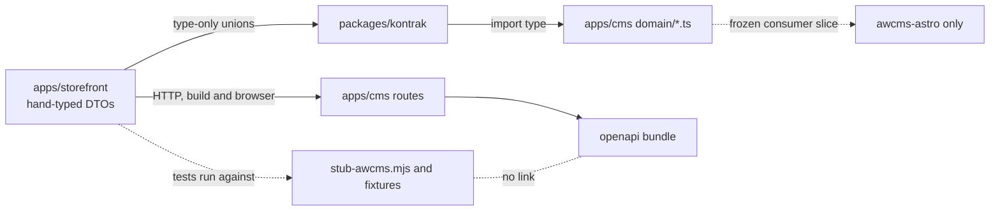

🇬🇧 English (source) · 🇮🇩 [Bahasa Indonesia](audit-paritas-kontrak-cms-storefront.id.md)

# Contract parity audit: CMS and storefront, three profiles (issue #547)

A research report, not a specification and not a gate. It records what is **proven** today about the contract between `apps/cms` (provider) and `apps/storefront` (consumer) for the `toko`, `berita` and `landing` profiles, what is only **assumed**, and what a follow-up should add. It changes no code, schema, workflow or test.

- **Baseline:** `origin/main` `66b9985ad753d815ad8f85f6392487087f4a8e8f` (19 November 2026). Every statement below is true of that tree unless it says otherwise.
- **Date of audit:** 20 November 2026.
- **Ownership rule applied:** [ADR-0024](adr/0024-awcms-one-is-template-only-derived-apps-own-their-backend.md). This repository is a template; a finding is placed with the repository that owns the code. Nothing here asks the template to carry a product's requirement or a derived product's tenant.
- **Flow position:** the research input to the contract-first steps of the development flow (steps 4 to 9 in [`AGENTS.md`](../AGENTS.md)). It does not declare gate 9 passed. Under the owner's rule of 19 November 2026, user acceptance testing (step 14) is not run here; it runs in each derived repository.

The dotted "no link" edge is the central finding (F-01, F-02): the storefront's tests and end-to-end runs exercise a hand-written stub, and nothing connects that stub to the OpenAPI document the CMS is checked against.

## 1. Evidence classes

| Class | Meaning |
| --- | --- |
| VERIFIED | Proven by a test, a gate, or a command run for this report, or by reading the cited source path. The evidence is named. |
| ASSUMED | Believed true, not proven here. The reason is stated. |
| PLANNED | An open issue or document already commits to it. It is not built. |
| DEFERRED | Known, low impact today, deliberately not pursued by this report. |

## 2. What was run

| Command (from the worktree root unless stated) | Result |
| --- | --- |
| `bun install --frozen-lockfile` | success, 329 packages |
| `bun test tests/kontrak-arah-impor.test.mjs` | 2 pass, 0 fail |
| `bun run ci --leg local-ci/check-toko --leg local-ci/check-berita --leg local-ci/check-landing` | all three PASS (`check-toko` 117.9 s with 10 steps, `check-berita` 8.5 s and `check-landing` 7.9 s with 4 steps each) |
| `bun run ci --leg local-ci/e2e-landing` | PASS (31.3 s) |
| `bun run ci --leg local-ci/e2e-toko --leg local-ci/e2e-berita` | both PASS (`e2e-toko` 76.9 s, `e2e-berita` 46.5 s) |
| `cd apps/cms && bun scripts/api-spec-check.ts` | `api:spec:check passed.`; `ROUTE_PARITY_EXEMPTIONS` is empty |
| `cd apps/cms && bun scripts/api-consumer-contract.ts --check` | OK, 15 consumer paths, all for `awcms-astro` |
| `cd apps/cms && bun test tests/customer-bearer-body-boundary.test.ts tests/commerce-cors.test.ts tests/commerce-storefront-idempotency.test.ts tests/openapi-bundle.test.ts` | 49 pass, 0 fail (no database needed) |

**Not run, and why.**

- `local-ci/check-cms` and the `tests/integration/` suites: they need an ephemeral `postgres:18.6` container and a disposable database. The audit environment was not given one, so no database-backed claim below is VERIFIED by execution. Such claims cite the test file that covers them and say "not executed".
- `local-ci/template-*` and `local-ci/security`: out of scope for a contract audit.
- No claim in this report says the latest CI passed on any SHA other than the one above. `ci:pr` was not run: this PR changes documentation only and nothing was posted as a status.

**Ad hoc checks, not committed.** Three throwaway scripts (kept outside the repository) did the mechanical comparisons used in F-02 to F-09: a path-and-method comparison of the storefront client calls against the bundled OpenAPI, a structural comparison of each storefront fixture against its OpenAPI response schema, and a scan of handler source for `RATE_LIMITED` against the declared responses. Their method is described where used so a reviewer can reproduce it; a permanent version is a recommendation, not part of this change.

## 3. What already exists and is VERIFIED

| Guard | What it proves | What it does not prove |
| --- | --- | --- |
| `tests/kontrak-arah-impor.test.mjs` | No file under `apps/cms/src` imports `apps/storefront`, `packages/kontrak` or an `@awcms-one/*` package. Run: 2 pass. | Anything about the other direction (that `packages/kontrak` imports only `domain/` files); the test says that is a per-PR review concern. |
| `packages/kontrak` (`index.ts`, `katalog.ts`, `pesanan.ts`, `promosi.ts`) | 14 string-literal unions re-exported with `export type` from `apps/cms` `domain/*.ts`; no runtime value. A widened union becomes a storefront compile error at an exhaustive `switch`. | Any object shape. The docblocks state that DTO shapes are deliberately kept local to the storefront. |
| `apps/cms` `api:spec:check` | OpenAPI paths and API route handlers agree (route parity); the exemption set is empty. | Response shapes, and routes outside `/api` (see F-07). |
| `apps/cms` `api:consumer-contract:check` | The frozen slice that `awcms-astro` calls stays an additive subset of the bundle. | The storefront in this repository is not in that slice (F-01); see the next row for its build-time half. |
| `tests/storefront-consumer-contract.test.mjs` with `tools/lib/storefront-consumer-contract.mjs` (issues #555 and #556, ADR-0058 D2) | The 20 operations `apps/storefront` reads while `astro build` runs and the 53 it calls in the browser, per profile, are frozen in `tests/fixtures/storefront-consumer-contract.json` with their transitive schemas. Responses stay an additive subset of the committed bundle; request bodies and parameters follow the reverse rule (the provider must keep accepting what the storefront sends: no new required field or parameter, no removed property, no narrowed type, enum, format or bound). Each browser operation records its auth, the query and header parameters it sends, its Idempotency-Key behaviour and its negative cases (`204`, `401`, `404`, `409`, `429`), each with evidence in the storefront source; a `429` the bundle does not declare yet is marked pending upstream awcms#1385 (issue #557) instead of being invented. A source scan of `apps/storefront/src` fails on a build read, a `kirimPermintaan` call, a direct transport or any other `fetch`, `sendBeacon` or `XMLHttpRequest` that is not in the slice, and on a bearer call that left the session-clearing wrapper. `GET /theming/{tenantCode}/tokens.css` is named as out of the bundle (F-07) with a reason; no schema is invented for it. Regenerate only with `bun run contract:storefront:generate --reason "<why>"`. | Which page group reaches which operation (the per-profile mapping is hand-reviewed, the source scan proves the set of operations and readers); a path assembled from an imported value; the `tokens.css` body; which statuses a page handles beyond the one token of evidence per case; the two payment-proof request bodies the bundle does not declare (named in `REQUEST_BODY_UNDECLARED`). |
| `apps/cms/tests/customer-bearer-body-boundary.test.ts` | Every `customerBearer` body operation in the OpenAPI is registered in the middleware or deliberately session-free. | The live session lookup, which is database-gated and was not executed here. |
| `apps/cms/tests/commerce-cors.test.ts`, `commerce-storefront-idempotency.test.ts` | Preflight policy: no credentials header, origin echo, `idempotency-key` in the allowed list for routes that take it. | A real browser against the real routes (F-10). |
| `apps/storefront/tests/*-kontrak.test.ts`, `toko-klien.test.ts`, `kirim-tunggal-kontrak.test.ts` | Client-side behaviour: envelope, `204`, `RATE_LIMITED` with `Retry-After`, single-flight, idempotency key reuse. | That the server sends what the client was tested against. |
| `local-ci/check-*` and `local-ci/e2e-*` | Type check and smoke per profile; browser flows per profile, against `apps/storefront/scripts/stub-awcms.mjs`. | Anything the stub does not model (F-02, F-09). |

The defect class this audit is looking for already happened once. The 14 November 2026 changeset `.changesets/2026-11-14-customer-bearer-body-boundary.md` records that fifteen mutating customer routes answered `401 AUTH_REQUIRED` in the middleware, and that "handler-level tests and `api:spec:check` never saw it". The storefront was green throughout because its stub never had that middleware.

## 4. Matrix: operation to evidence, per profile

Reading the columns. **Caller** is who sends the request: *build* is `astro build` with the machine credential `AWCMS_API_TOKEN`; *browser* is the shopper or reader, cross-origin, with no cookie. **DTO** is where the consumer's type comes from. **Stub** is whether `apps/storefront/scripts/stub-awcms.mjs` serves it. **Status** is the evidence class for "the consumer's expectation equals the provider's behaviour".

Profile membership follows `apps/storefront/src/config/profil.ts` and `apps/storefront/integrations/profil.mjs`: `toko` is the shared pages plus the `toko` group plus the `berita` group; `berita` is the shared pages plus the `berita` group; `landing` is the shared pages only.

### 4.1 Shared by all three profiles

| Operation | Caller and auth | DTO source | Error and edge handling | Tenant | Stub | Test or gate | Status |
| --- | --- | --- | --- | --- | --- | --- | --- |
| `GET /api/v1/site-profile/composed` | build, bearer | local `SiteProfile` in `apps/storefront/src/lib/awcms/profil.ts` | build fails loud without credentials (`client.ts`) | token | fixture | `profil.test.ts`, `profil-konfig.test.ts`; fixture matches the schema (F-02) | VERIFIED shape, ASSUMED behaviour |
| `GET /theming/{tenantCode}/tokens.css` | build, none, raw CSS | none (raw text) | non-`200` handling in `apps/storefront/src/lib/awcms/theme.ts` | `AWCMS_TENANT_CODE` | fixture | `theme.test.ts` | **not in OpenAPI** (F-07) |
| `GET /api/v1/blog/pages/public` and `/{slug}` | build, bearer | local types in `apps/storefront/src/lib/awcms/pages.ts` | `null` for a missing page | token | fixture | build smoke only: no unit test imports `apps/storefront/src/lib/awcms/pages.ts` | VERIFIED shape (fixture clean), ASSUMED behaviour |
| `GET /api/v1/media/objects?ids=` and `/media/public-origin` | build, bearer | local types in `apps/storefront/src/lib/awcms/media.ts` | partial results tolerated | token | stub mirrors the real filter | `awcms-media.test.ts` | VERIFIED for `public-origin`; `objects` fixture is a lookup table, not a response, so not comparable |
| `POST /api/v1/analytics/collect` | browser, anonymous, origin-bound | none | beacon, fire and forget | origin | stub | `analitik*.test.ts`, and `analytics-beacon-cors.test.ts` in `apps/cms` | VERIFIED unit level, ASSUMED end to end |
| `/csp.json` and shared `halaman/[slug]` at build | build | n/a | a landing build without a CMS fails today | n/a | n/a | open issue #535 | PLANNED |

### 4.2 `toko` group (also built by the `toko` profile only)

| Operation | Caller and auth | DTO source | Error and edge handling | Idempotency | Stub | Test or gate | Status |
| --- | --- | --- | --- | --- | --- | --- | --- |
| `GET /api/v1/commerce/{products,categories}` | build, bearer | local `CommerceProduct`; unions from `packages/kontrak` | keyset pages | none | fixture | `katalog-catalog.test.ts` | **stale fields** (F-03) |
| `GET /api/v1/commerce/{store-settings/public,sliders,flash-sales,vouchers,testimonials,popups}` | build, bearer | local types in `apps/storefront/src/lib/awcms/pemasaran.ts` | `null` popup | none | fixtures | `katalog-pemasaran.test.ts` | store settings **stale** (F-04) |
| `POST .../storefront/cart/quote` | browser, optional bearer | local `CartQuote` in `toko-klien.ts` | `CART_CHANGED` carries a fresh quote | none | state machine | `toko-klien.test.ts`, `checkout.e2e.ts` | VERIFIED client side; money as strings; `tax` narrower than spec (F-11) |
| `POST .../storefront/orders` | browser, optional bearer | local `Order` | `409`, `401` explicit when bearer is stale | key in body | state machine | `checkout.e2e.ts`, `checkout-ulang-jaringan.e2e.ts` | VERIFIED against the stub only |
| `GET .../orders/{code}`, `POST .../cancel`, `.../payment-confirmations` | browser | local `Order` | neutral `404` | optional header, prose only (F-08) | state machine | `pesanan-poll.test.ts` | VERIFIED against the stub only |
| `POST .../payment-gateway/sessions` | browser | local | `503` when no gateway | none | state machine | `gateway-build-smoke.test.ts` | VERIFIED against the stub only |
| `POST .../payment-proof/upload-sessions` and `/finalize` | none: no page calls them | `UploadSession` in `toko-klien.ts` | the CMS answers `503` always | none | `503` | none | DEFERRED, spec says "reserved" (F-12) |
| `POST .../reviews` | browser, optional bearer | local | `409` | optional header, prose only | state machine | `toko-klien.test.ts` | spec lacks `429` (F-09) |
| `.../account/otp/{request,verify}`, `me`, `logout` | browser, bearer after verify | `akun-kontrak.ts` | `401` clears the stored session; `204` on logout | prose only | state machine | `akun-klien.test.ts`, `akun-kontrak.test.ts`, `daftar-ketuk-ganda.e2e.ts` | VERIFIED client side; the middleware boundary has no storefront-side proof |
| `.../account/{addresses,wishlist,orders,reviews,affiliate,conversations,loyalty}` | browser, bearer | local types in `akun-klien.ts` | `204` for deletes, `409`, `429` | prose only | state machine, **loyalty absent** | `akun-klien.test.ts`, `poin-kontrak.test.ts` | VERIFIED client side; `loyalty` has no stub route (F-13) |
| `.../account/push/*` | browser, bearer | local types | `204`, `429`, `413`, `415`, `422` | none | `stub-push.mjs` | `push-*.test.ts`, `akun-notifikasi.e2e.ts` | VERIFIED against the stub; issue #430 is still open while `docs/api.md` calls it implemented (F-14) |
| `.../booking/{offerings,availability,quote,reservations...}` | browser, bearer for own reservations | `booking-kontrak.ts` | `HOLD_LIMIT_EXCEEDED`, `SLOT_UNAVAILABLE`, money strings compared exactly | **required header, declared in spec** | `stub-booking.mjs` | `booking-kontrak.test.ts`, `booking.e2e.ts` | VERIFIED against the stub; the only group with a machine-readable idempotency contract |
| `GET .../products/{id}/download`, `.../account/entitlements*`, `.../document-links/{token}` | no storefront caller found | none | n/a | n/a | none | none | DEFERRED (spec only) |
| `GET /api/v1/idn-regions/regions` | build and checkout | `wilayah.ts`, `wilayah-checkout.ts` | bounded concurrency | none | fixture | `wilayah-checkout.test.ts` | fixture **outside the enum** (F-05) |

### 4.3 `berita` group (built by `toko` and `berita`)

| Operation | Caller and auth | DTO source | Stub | Test or gate | Status |
| --- | --- | --- | --- | --- | --- |
| `GET /api/v1/blog/{posts,terms,institutions}` | build, bearer | local types in `apps/storefront/src/lib/awcms/blog.ts` | fixtures, trimmed | `berita-routes.test.ts`, `berita-build-smoke.test.ts` | trimmed projections (F-02) |
| `GET /api/v1/news-portal/ad-placements/active` | build, bearer | local | fixture | `iklan-popup.e2e.ts` | VERIFIED shape (fixture clean) |
| `GET /api/v1/seo/redirects` | build, bearer | local `RawRedirect`, a declared subset | fixture, trimmed | `pengalihan-aturan.test.ts`, `berita-build-smoke.test.ts` | trimmed projection (F-02) |
| `GET /api/v1/analytics/pages?range=7d` | build, bearer | local | fixture | `analitik-terpopuler.test.ts` | VERIFIED shape (fixture clean) |
| `POST /api/v1/newsletter/{subscribe,confirm,unsubscribe}` | browser, anonymous | `apps/storefront/src/scripts/buletin.ts`, local | stub | `newsletter-path-contract.test.ts` | VERIFIED for the two e-mail link paths by file existence; request and response shapes ASSUMED |
| `GET /api/v1/news-portal/homepage-sections/composed` | none: deliberately not called | n/a | n/a | n/a | DEFERRED, `blog.ts` explains why |

### 4.4 Per-profile summary

| Profile | Operations it depends on | Strongest evidence | Weakest evidence |
| --- | --- | --- | --- |
| `landing` | the shared set in 4.1 only | `check-landing` PASS, `e2e-landing` PASS (this report) | cannot build without a CMS (#535); all shared reads are stub-only |
| `berita` | 4.1 plus 4.3 | `check-berita` PASS; all six build-time reads are either clean fixtures or declared subsets | newsletter request and response bodies; trimmed fixtures |
| `toko` | 4.1, 4.3 and 4.2 | `check-toko` PASS; the largest client test set; money as strings | every browser call is proven against the stub only; the CMS middleware boundary and per-route CORS are not exercised from the storefront side |

## 5. Protocol: a TypeScript type is not a contract

`packages/kontrak` answers one question: does the consumer's closed vocabulary still contain every value the provider can emit. That is necessary and it is cheap. It does not answer the others below, and this report recommends no change that would make it try: **no runtime import from `packages/kontrak`, and the import-direction guard stays mandatory** (see section 8).

| Concern | A type proves | What must be proven another way | Where it is proven today |
| --- | --- | --- | --- |
| Field names and types | only for the 14 unions | request and response shape against the OpenAPI schema | provider side only; storefront side by hand (F-02) |
| Envelope `{success, data}` and error `{code, message, details}` | nothing | the consumer parses the provider's error codes, including unknown ones | `toko-permintaan.ts` plus unit tests; stub codes are hand-written |
| `204 No Content` | nothing | the client does not call `.json()` on it | `toko-permintaan.ts` returns early on `204`; VERIFIED by reading and `toko-klien.test.ts` |
| `429` and `Retry-After` | nothing | provider declares `429` on every limited route; client reads the header | client VERIFIED; spec incomplete (F-09); no stub route emits `RATE_LIMITED` |
| Idempotency | nothing | provider declares the header or body key; client sends one stable key per attempt | client VERIFIED (`kunci-idempotensi.test.ts`); spec declares the header on two operations only (F-08) |
| CORS and preflight | nothing | the preflight answer lists every header the client sends, per route | provider unit-tested; the stub answers one uniform list for every route (F-10) |
| Tenant resolution | nothing | the request `Origin` resolves the tenant; an unresolvable origin gets a neutral `404` | stub models it; real routes covered by database-gated tests not executed here |
| Customer bearer | nothing | a `cs_` token passes the middleware for body-carrying routes | provider test exists after the 14 November fix; no consumer-side proof |
| Money | nothing | a `numeric(14,2)` amount crosses as a string and is not parsed for arithmetic | VERIFIED: `apps/storefront/src/lib/harga.ts` converts to a `Number` for display only, with a guard test; `katalog-harga.test.ts` |
| UI states | nothing | loading, empty, error, `401` and `429` each have a state | per page, mostly through e2e against the stub; no inventory exists (F-15) |

## 6. Findings

Severity is the effect on a shopper or reader if the gap is real, not the effort to close it. "Owner" is the repository that owns the fix (ADR-0024 D2).

| ID | Finding | Class | Evidence | Severity | Owner |
| --- | --- | --- | --- | --- | --- |
| F-01 | No frozen consumer contract exists for the storefront's calls. `api:consumer-contract:check` freezes 15 paths, all for `awcms-astro`. None of the 41 storefront operations the client calls, and none of the build-time reads, is frozen, so a response change in a subtree sync is not caught before the storefront runs. | VERIFIED | `apps/cms/scripts/api-consumer-contract.ts`; run: OK, 15 paths | high | `awcms-one` for the slice; `awcms` for the mechanism (see section 8) |
| F-02 | The stub fixtures are hand-written and no gate compares them with the OpenAPI schema. A structural comparison of 19 fixtures found 11 clean, 3 that contradict the schema (F-03 to F-05), 4 that omit required fields (blog posts, terms, institutions, redirects; consumed as declared subsets), and 1 that is a lookup table rather than a response. | VERIFIED | ad hoc comparison against `apps/cms/openapi/awcms-public-api.openapi.yaml` at the baseline SHA | high | `awcms-one` |
| F-03 | `downloadLink` is absent from the public product record by design (the OpenAPI header says so and `toAdminRecord` adds it only for admins), yet the fixture carries `downloadLink: null` and the storefront type `CommerceProduct` declares `downloadLink: string \| null` as required. The type claims a field the provider no longer sends. **Status: fixed by #554** (fixture and `CommerceProduct` no longer carry the field; nothing read it). | VERIFIED | `apps/cms/openapi/modules/commerce.openapi.yaml` header; `apps/cms/src/modules/commerce/application/product-directory.ts` `toAdminRecord`; `apps/storefront/src/lib/catalog.ts` | low (no page reads it) | `awcms-one` |
| F-04 | The `store-settings-public` fixture has `payment.tax` without `mode`, although the schema makes it a discriminated union on `mode` (closed issue #324), and a `shipping.courier` object the schema does not list. Fixture stale against provider behaviour. Whether the live route sends `shipping.courier` was not traced. **Status: fixed by #554.** Traced: the live route does not send `shipping.courier` (`toPublicRecord` sends `courierEnabled` only), so the fixture and the `courier?` type member were removed and the stub reads `courierEnabled`; `payment.tax.mode` added. | VERIFIED for the fixture, ASSUMED for the route | schema `CommerceStoreSettingsPublic`; fixture file | medium | `awcms-one` |
| F-05 | The regions fixture has `regionType: "city"`; the schema enum is `province`, `regency`, `district`, `village`. The storefront types the field as `string`, so no compiler would notice a real value outside the set. **Status: fixed by #554**: the provider emits `regency` for a city (level 2); the fixture now says so, and no storefront code compared against `city`. | VERIFIED | `apps/cms/openapi/modules/idn-admin-regions.openapi.yaml`; `apps/storefront/src/lib/awcms/wilayah.ts` | low | `awcms-one` |
| F-06 | `packages/kontrak` is narrower than its name suggests: 14 unions, no object shapes, by design. `PaymentMethod`, `PaymentStatus` and `ShippingMethod` are exported but imported nowhere in the storefront. This is consistent with the issue #6 decision; the gap is that nothing else compensates (F-01). | VERIFIED | `packages/kontrak/src/*.ts`; whole-word search of `apps/storefront/src` and `tests` | low | `awcms-one` |
| F-07 | `GET /theming/{tenantCode}/tokens.css` is read by every profile at build time and is not in the OpenAPI bundle, so `api:spec:check` does not cover it. A change to that route reaches the storefront with no signal. | VERIFIED | route file `apps/cms/src/pages/theming/[tenantCode]/tokens.css.ts`; zero matches in the bundle; call at `apps/storefront/src/lib/awcms/theme.ts` | medium | `awcms` (route and contract) |
| F-08 | Idempotency is machine-readable on two booking operations only. Twelve other mutating storefront operations mention idempotency in prose with no header parameter, and nine other route files reference it. The named remedy in upstream ADR-0129 (`IdempotencyKeyOptional`) does not exist. | VERIFIED | `apps/cms/openapi/awcms-public-api.openapi.yaml`; route search; upstream ADR-0129 | medium | `awcms` |
| F-09 | 25 storefront operations whose handler source contains the literal `RATE_LIMITED` declare no `429` response, including `POST /reviews` and `GET /products/{productId}/download`. The count is a static heuristic: a per-route check is needed before the spec is edited. No stub route returns `RATE_LIMITED`, so the client branch is proven by unit tests only. | VERIFIED (heuristic) | handler scan against the bundle; `apps/storefront/scripts/stub-awcms.mjs` | medium | `awcms` for the spec; `awcms-one` for the stub |
| F-10 | The stub answers one uniform `Access-Control-Allow-Headers` list on every storefront route, while the real routes each declare their own list. The stub is therefore more permissive than the provider, and the e2e runs cannot detect a missing header on one route. | VERIFIED by reading | stub preflight (`Content-Type, Authorization, Idempotency-Key`); real `OPTIONS` handlers under `apps/cms/src/pages/api/v1/commerce/storefront` | medium | `awcms-one` |
| F-11 | The storefront models `CartQuote.tax` as `{active, percent, amount}`. The spec adds `mode`, `inclusive`, `error` and `engine`, and in engine mode `active` and `percent` are not promised. No page renders tax, so the effect is nil today. | VERIFIED type gap, DEFERRED impact | `apps/storefront/src/lib/toko-klien.ts`; schema `CommerceCartQuoteResult` | low | `awcms-one` |
| F-12 | The payment-proof upload client functions exist and no page calls them; the provider always answers `503`. Reserved on both sides. | VERIFIED, DEFERRED | `apps/storefront/src/lib/toko-klien.ts`; `apps/cms/openapi/modules/commerce.openapi.yaml` | none | n/a |
| F-13 | `GET .../account/loyalty` is called by checkout (`ambilPoin`) and has no stub route, so the points flow is exercised by unit tests only, not by any browser run. | VERIFIED | `apps/storefront/src/lib/akun-klien.ts`; `grep loyalty scripts/stub-awcms.mjs` empty | low | `awcms-one` |
| F-14 | `docs/api.md` calls customer Web Push implemented while issue #430 is open. One of them is stale. Not resolved here. | VERIFIED discrepancy, cause ASSUMED | `docs/api.md`; issue list | low | `awcms-one` |
| F-15 | No inventory exists of which UI states (loading, empty, error, `401`, `429`) each page implements, so "UI states" in the issue cannot be audited beyond the e2e flows listed in the matrix. | VERIFIED absence | no document or test enumerates them | medium | `awcms-one` (needs the UX step first) |
| F-16 | Per-profile browser coverage is uneven by design: checkout, booking, push settings and account flows run only under `toko`; the news ad popup only under `berita`; `landing` has the shared accessibility and navigation runs. | VERIFIED | `test.skip(!isGroupActive(...))` in `apps/storefront/tests/e2e` | informational | n/a |

### 6.1 Interaction with PR #530

PR #530 (`integration/2026-11-11-close-out`, head `6413f4f4a2bf39d5ab34450ef7997df7183a0a52`, state OPEN, mergeability UNKNOWN at the time of audit) is owned by someone else and was not touched, merged, rebased onto or tested here. This report is based on `origin/main` `66b9985ad753d815ad8f85f6392487087f4a8e8f`.

PR #530 can change these findings:

- **Customer-bearer boundary.** `origin/main` already contains the fifteen-route fix (changeset of 14 November 2026, test run above). The PR body says its registry grows to eighteen entries by adding three `privacy/*` routes for issue #529. After it merges, the registry count, the matrix in 4.2 and F-09's operation count will each be higher.
- **New storefront surface.** The PR adds `/akun/privasi` and its routes. Neither is in this audit.
- **Contract draft #464.** Draft only; not audited.
- **Subtree base.** The PR's subtree sync predates `origin/main` (which has since synced to a later upstream). The PR notes it is stacked on #543, which is merged. Re-run the numeric findings (F-08, F-09) after the PR lands.

No finding here depends on a file the PR changes in a way that makes it wrong today; each may need a count updated afterwards.

## 7. Mock or lightweight fixture: when, and who owns it

The question in step 3 of the issue. Three tiers, with an owner for each.

| Tier | Use it when | Owner | Cost |
| --- | --- | --- | --- |
| **Fixture** (hand-written JSON, as `tests/fixtures/awcms/` is today) | the consumer reads a declared subset, the response is small and stable, and a person must be able to read the data as plain JSON | `awcms-one` for the template baseline; each derived product for its own content | low, but drifts silently (F-02 to F-05) |
| **Fixture plus schema check** (a gate that validates each fixture against the OpenAPI response schema, allowing declared subsets) | the fixture is the only thing standing between the consumer and the provider's real shape | `awcms-one` for the gate and the fixtures; `awcms` provides the schema and is not asked to change | low to medium; closes F-02 to F-05 without new generation tooling |
| **Generated mock** (a server generated from the OpenAPI document, including error and `429` examples) | a consumer is being built before its provider (step 11.1 against the step 8 contract), or when stateful flows such as quote, order and cancel must match a spec rather than a person's memory of it | the generator and its configuration are generic and belong upstream in `awcms`; the per-product seed data belongs to the product repository | medium to high; also adds a dependency |

Recommendation, as a proposal for the owner, not a decision: adopt **fixture plus schema check** in this repository first, because it needs no new runtime dependency and removes the largest verified gap. Treat a generated mock as an upstream proposal to `awcms` only if more than one consumer needs it. The three tiers are not exclusive; the second is a strict improvement of the first.

## 8. Recommendations, with decisions that wait for the owner

1. **Keep the import-direction guard and the type-only rule.** Do not add a runtime import from `packages/kontrak` and do not widen it to object shapes: the docblocks give the reason (a static public site must not carry `apps/cms` code into a client bundle) and nothing in this audit contradicts it.
2. **Close F-01 and F-02 together** with a storefront consumer-contract slice and a fixture-versus-schema check that runs in `local-ci/check-toko`. The slice follows the same additive-subset rule `api:consumer-contract:check` already uses. The mechanism lives in `apps/cms`, which this repository must not edit directly; the storefront slice can live at the repository root (`tests/` or `tools/`), so no subtree change is needed to start.
3. **Report F-07, F-08 and F-09 upstream** (`awcms`) rather than patching `apps/cms` here: add the raw CSS route to the contract or to an explicit non-API allow-list, add an optional-header parameter component, and complete the `429` responses after a per-route check.
4. **Fix F-03 to F-05 in the fixtures and the storefront type** once the gate in item 2 exists, so the gate is what turns them red first.
5. **Do not open implementation issues until gate 9.** The epic that owns this work forbids it; the proposals below are text for that later step.

### 8.1 Owner decisions (decided 20 November 2026)

The three decisions that waited for the owner were decided on 20 November 2026 and are recorded in [ADR-0058](adr/0058-contract-parity-fixtures-with-schema-check-consumer-slice-at-the-root-and-generic-gaps-go-upstream.md).

| Decision | Outcome | Where it goes |
| --- | --- | --- |
| Where the consumer-contract slice lives | root `tests/` of this repository, not `apps/cms` (a subtree) | [#555](https://github.com/ahliweb/awcms-one/issues/555), [#556](https://github.com/ahliweb/awcms-one/issues/556) |
| Mock strategy | fixture plus schema check first; a generated mock follows only if needed | [#553](https://github.com/ahliweb/awcms-one/issues/553), [#554](https://github.com/ahliweb/awcms-one/issues/554) |
| Whether `RATE_LIMITED` and `IdempotencyKeyOptional` belong in the generic `awcms` contract | yes, reported upstream and not patched in `apps/cms`: [ahliweb/awcms#1385](https://github.com/ahliweb/awcms/issues/1385) (upstream also chose to publish a pinned fixture pack for consumers) | [#557](https://github.com/ahliweb/awcms-one/issues/557) adopts it after the next subtree sync |

### 8.2 Proposed acceptance criteria and Definition of Ready for later atomic issues

These began as proposals. After the owner decisions of 20 November 2026 (section 8.1) they were opened as backlog issues #553 to #557, all waiting for gate 9 and the Definition of Ready and none implemented: Issue A is #553 (with #554 for F-03 to F-05), Issue B is #555 and #556, and the upstream follow-up is #557. Duplicate check at the baseline (before those issues existed): no open or closed issue in this repository covers fixture-to-schema parity or a storefront consumer-contract slice. Related, and not duplicates: #6 (closed, type-only foundation), #430 and #431 (push), #535 (landing build without a CMS), #420 (upstream tracking).

**Issue A. Fixture versus schema gate.**

- Given each fixture under `apps/storefront/tests/fixtures/awcms`, the gate resolves the matching OpenAPI response schema and fails on a value outside an enum, a type mismatch, or a property the schema does not declare; fixtures declared as subsets are listed with the fields the consumer reads.
- The gate runs in `local-ci/check-toko`, needs no database and no network, and is added to the leg description in `tools/ci/legs.ts`.
- F-03, F-04 and F-05 are fixed in the same change or the gate carries named, dated exceptions.
- Does not edit `apps/cms`, does not import from `packages/kontrak`, adds no runtime dependency to it.

**Issue B. Storefront consumer-contract slice.**

- A frozen file lists the operations and schemas the storefront calls, in the additive-superset form of `api:consumer-contract:check`.
- Regenerating it is a deliberate act with a stated reason in the pull request.
- Covers the build reads and the browser calls, and names F-07's route explicitly.

**Definition of Ready for both.** The step-8 contract for the surface is reviewed; the profiles each operation belongs to are listed (section 4); the negative cases (`401`, `404`, `409`, `429`, `204`) are named per operation; the owner of each fixture is stated; no consumer-specific content enters the template (ADR-0024 D3).

## 9. Acceptance criteria of issue #547

| Criterion | Where it is met |
| --- | --- |
| Matrix of three profiles with operations, DTO source, error type, auth and tenant, E2E or gate, and evidence status | section 4 |
| Protocol separating TypeScript types from HTTP behaviour, including error path, idempotency, CORS, `204` and money precision | section 5 |
| No runtime import recommended from `packages/kontrak`; import guard kept | sections 3 and 8 item 1 |
| No product or production-tenant work placed in the template; ADR-0024 respected | header and section 8 |
| Test and ADR recommendations, dependency, profiling and gap-closure status, without claiming the latest CI ran | sections 2, 6 and 8; "profiling" is limited to the run times in section 2 |

Limits the reader should keep in mind: database-backed behaviour was not executed; the fixture comparison and the `RATE_LIMITED` scan are throwaway static checks; the audit read a snapshot and PR #530 may change it.

## Changelog

### 2026-11-24 (issues #557, #571, #570)

- #571 declared the request bodies of the payment-proof upload-session and finalize operations and a real schema for the saved-address create; `REQUEST_BODY_UNDECLARED` is now empty.
- #557 declared `429`, `Retry-After` and `Idempotency-Key` on the commerce operations whose handlers apply them (the `apps/cms` contract-parity exemption list went from 102 entries to 1, `POST /api/v1/commerce/quotations/{id}/convert`, whose handler cannot answer 429). 21 browser operations lost their "pending upstream" 429 marker; 5 keep it (`GET`/`PATCH /account/me`, `POST /account/logout`, and the two payment-proof operations), where the storefront handles a 429 generically but the handler applies no limiter.
- #570: a stale-bearer 401 on `createOrder`, `createGatewaySession` and `submitReview` now clears the stored session.

### 2026-11-24 (F-03 to F-05, N-01, N-02 resolved, issue #554)

- F-03, F-04, F-05 and N-01 are fixed in the fixtures and the storefront types, and their exceptions are deleted from `tests/support/fixture-skema-mapa.mjs` (the gate proves it). N-01: the provider's `copyrightStatus` enum has `owned`, never `own_work`; the fixture now says `owned` and no code read the old value.
- N-02 is **not** a fixture defect: the provider emits and the storefront renders `title`, `caption`, `durationSeconds` and `sourceLabel` on a `videoNews` node, but the OpenAPI `PortableTextNode` lists only `provider` and `videoId`. It stays as the one exception, reasoned as an upstream spec gap to be reported to `ahliweb/awcms` (review date 15 December 2026).

### 2026-11-24 (gate for F-02 landed, issue #553)

- The fixture-versus-schema gate of Issue A now exists: `tests/fixture-skema-openapi.test.mjs` with the map and the dated exceptions in `tests/support/fixture-skema-mapa.mjs`, run by the root `bun test` (`local-ci/check-toko`). All 24 fixture files are mapped: 11 clean responses, 3 responses that violate the schema (F-03 to F-05) and are carried as exceptions, 4 declared subsets, 2 lookup tables and 4 not-a-response files. F-03, F-04 and F-05 are recorded as exceptions that point at #554 and are reviewed by 15 December 2026; the gate fails when one no longer matches, so #554 must delete them. The first run found two violations this audit did not list (exceptions N-01: `own_work` in `media-objects.json`; N-02: `videoNews` fields the spec does not declare, in `blog-posts.json`). Findings and baseline of the audit are otherwise unchanged.
### 2026-11-24 (issue #556)

- The same frozen file now carries `phase: "browser"` for the operations the storefront calls from `apps/storefront/src/lib/**` and `src/scripts/**` (F-01, browser half). The audit counted 41; the source has 49 `kirimPermintaan` call sites (37 in `akun-klien.ts`, 12 in `toko-klien.ts`) plus the three newsletter calls and the page-view beacon, 53 in all, and the scan holds the list to the source. Per profile: `toko` 53, `berita` 4 (newsletter and beacon), `landing` 1 (the beacon); accounts, cart, orders, booking and push exist only in `toko`.
- Found while freezing, each reported here and not patched: `POST .../orders/{orderCode}/payment-proof/upload-sessions` and its `finalize` declare no request body in the bundle although the storefront sends one (named in `REQUEST_BODY_UNDECLARED`, to be reported upstream); `POST .../account/addresses` declares its body as a bare `{ type: object }`, so the request rule has nothing to hold there; `createOrder`, `createGatewaySession` and `submitReview` send an optional bearer but are not inside the session-clearing wrapper, so a stale-bearer `401` shows the generic error and leaves the stored session (the bundle declares `401` for all three). `429` remains pending upstream (awcms#1385, issue #557) for the operations whose handler the bundle does not declare it on: 26 of the 52 browser calls that record a `429` (the beacon records none).

### 2026-11-24 (issue #555)

- Section 3 gains the guard row for the frozen storefront slice of build-time reads (half of F-01; the browser-call half is the #556 entry above). F-07 is unchanged: the route is now named explicitly in the slice, and the upstream report stays open.

### 2026-11-20 (owner decisions)

- Section 8.1 now records the three owner decisions of 20 November 2026 and points to ADR-0058; section 8.2 notes the backlog issues #553 to #557. Findings and baseline unchanged.

### 2026-11-20

- First version: matrix of operations to evidence for the three build profiles, protocol separating types from HTTP behaviour, sixteen findings with evidence classes, mock-versus-fixture ownership, proposed acceptance criteria and Definition of Ready, and the interaction with PR #530. Baseline `66b9985ad753d815ad8f85f6392487087f4a8e8f`.
